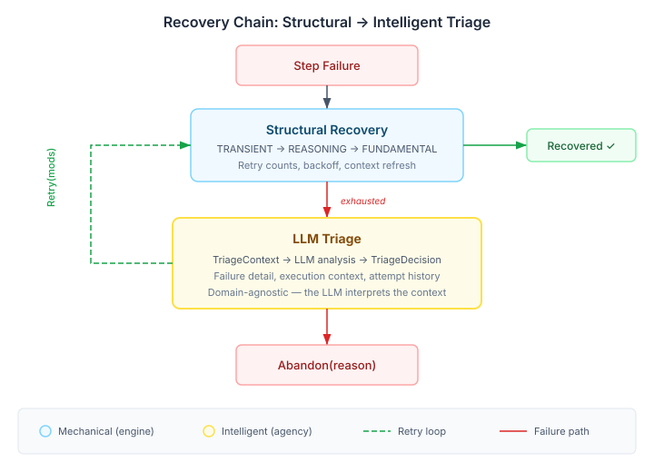
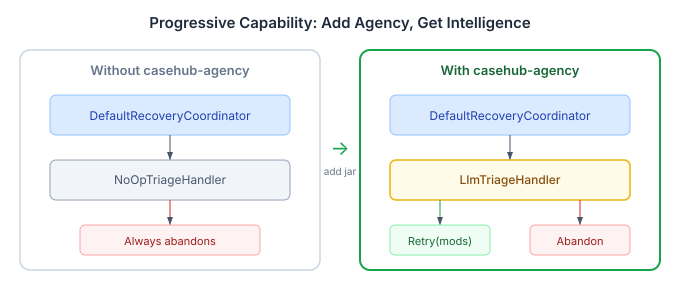

# When Retry Isn't Enough

Most failure recovery in orchestration systems is mechanical. Retry with backoff. Refresh context. Escalate through severity tiers. This works until it doesn't — and when it doesn't, the system gives up. The gap between "structural recovery exhausted" and "abandon" is where interesting failures live. Failures where the operation could succeed if something about *how* it runs changed.

## 1. The Recovery Chain Today

CaseHub's engine runs a three-level structural recovery chain when a playbook step fails:

| Level | What it does | When it helps |
|-------|-------------|---------------|
| TRANSIENT | Retry with backoff | Temporary network glitch, service restart |
| REASONING | Re-evaluate context, refresh data | Stale state, changed preconditions |
| FUNDAMENTAL | Re-plan with constraints | Resource unavailable, capability mismatch |

Each level is a heuristic. TRANSIENT assumes the failure is temporary. REASONING assumes the input was stale. FUNDAMENTAL assumes the plan was wrong for the current state. These cover the majority of failures in production systems — but they share a limitation: they don't look at *what actually failed*.

A playbook step that throws a NullPointerException on an email field will fail at every retry level. The data is wrong, not the infrastructure. No amount of backoff or context refresh fixes bad input. After three levels of structural recovery, the coordinator gives up. The `NoOpTriageHandler` returns `Abandon("no triage handler configured")` and the case stalls.



## 2. What the LLM Sees That Heuristics Can't

The `TriageHandler` SPI sits after structural recovery exhaustion. Its contract is simple:

```java
public interface TriageHandler {
    TriageDecision evaluate(TriageContext context);
}
```

Where `TriageContext` carries everything about the failure:

```java
public record TriageContext(
    String operationId,
    String operationType,     // "playbook", "workflow", "agent-loop"
    int attemptNumber,        // which attempt this is
    int maxAttempts,          // ceiling
    String failureSummary,    // human-readable
    Map<String, Object> failureDetail,    // structured: stepId, errorType, stack
    Map<String, Object> executionContext  // caseId, tenancyId, prior results
) {}
```

And the decision is sealed:

```java
public sealed interface TriageDecision {
    record Retry(Map<String, Object> modifications) implements TriageDecision {}
    record Abandon(String reason) implements TriageDecision {}
}
```

The interesting part isn't the interface — it's what an LLM can do with the `failureDetail` and `executionContext` maps that a heuristic can't.

A heuristic sees a NullPointerException. An LLM reads the full context: the step was `validate-input`, the exception was on field `email`, the execution context shows this is a batch import case where email is optional. The right answer isn't retry — it's `Retry({"playbook.skipStep": "validate-input"})`. Skip the validation step and let the pipeline continue with the data it has.

**This is not magic.** The LLM is doing exactly what a human operator would do when paged at 3am: read the error, read the context, decide whether the operation can proceed differently. The difference is latency and availability. An LLM triage takes seconds, not the twenty minutes it takes a human to context-switch, read the logs, and make a call.

## 3. Why Domain-Agnostic Works Here

The `LlmTriageHandler` in agency contains zero domain-specific code. No playbook knowledge. No awareness of step types or modification keys. It serializes `TriageContext` into a structured prompt and asks the LLM to decide.

This seems wrong — shouldn't the handler understand what it's triaging? But the failure detail and execution context maps are structured data produced by the domain. When the engine builds a `TriageContext` for a playbook failure, the `failureDetail` map contains `stepId`, `errorType`, the step's configuration. The LLM reads this as structured context and reasons over it. The handler doesn't need to know what a `stepId` is — the LLM does.

The modification keys returned by the LLM are also domain-defined. The engine's `PlaybookTriageModification` parser knows what `playbook.skipStep` means. The LLM learns these keys from the prompt context — the `operationType` tells it this is a playbook, and the failure detail shows the vocabulary of the domain. A workflow failure would produce different keys. An agent-loop failure, different again.

**A fair counter:** what if the LLM hallucinates modification keys the engine doesn't understand? The engine's parser ignores unknown keys. An LLM that invents `playbook.rewriteUniverse` produces a no-op modification — equivalent to a plain retry. The worst case isn't a wrong action; it's a wasted retry attempt. And the attempt counter tracks triage-initiated retries separately from structural retries, so an unhelpful LLM suggestion doesn't eat into the mechanical recovery budget.

## 4. Progressive Capability Without Configuration

The architecture is zero-config:



Platform defines the `TriageHandler` interface and ships a `NoOpTriageHandler` marked `@DefaultBean`. This is the out-of-the-box behaviour: structural recovery only, abandon on exhaustion.

Agency provides `LlmTriageHandler` marked `@ApplicationScoped`. CDI bean resolution means that when `casehub-agency` is on the classpath, the LLM handler displaces the no-op handler automatically. No property to set, no feature flag to toggle, no configuration class to write.

This is the same progressive-capability pattern we use for trust routing, attestation, and oversight gates. The platform defines the SPI with a safe default. Agency provides the intelligent implementation. Consumers that want intelligence add the jar. Consumers that don't, don't — and the system still works.

**The enterprise implication:** teams can adopt intelligent triage without coordinating a configuration change across environments. Add the dependency in the POM, deploy, and the next playbook failure that exhausts structural recovery will get LLM analysis instead of immediate abandonment. Roll it back by removing the dependency. The system degrades gracefully to the no-op handler.

## 5. Where This Leads

Triage is the first point in the recovery chain where the system can reason about *what went wrong* rather than just *that something went wrong*. But it's not the last.

The `TriageContext` already carries the full execution context — including results from prior steps. A future handler could use this to propose not just modifications to the current retry, but structural changes to the remaining plan. Skip a step. Reorder steps. Substitute an alternative worker for a capability that's failing. The `Retry(modifications)` map is deliberately `Map<String, Object>` — the engine can define new modification types without touching the SPI.

The sealed `Retry | Abandon` decision could also grow. A third variant — `Escalate(reason, suggestedAction)` — would let the LLM recommend human intervention with specific guidance rather than a generic failure notification. The triage handler already has the context to produce that guidance; the decision type just doesn't carry it yet.

For now, the value is concrete: playbook failures that would have been abandoned after structural recovery can now be analysed and potentially recovered with modifications. The LLM won't always get it right. But when the alternative is unconditional abandonment, getting it right some of the time is a significant improvement.
