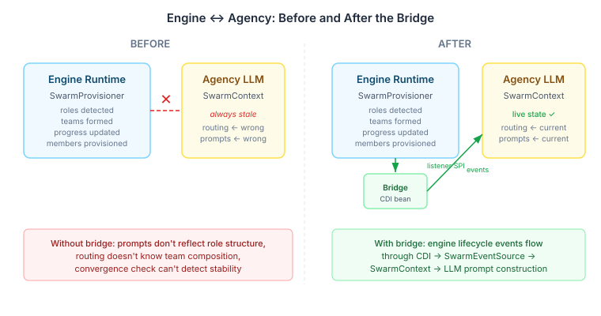

# The Swarm That Couldn't See Itself

A swarm that can't observe its own structure is flying blind. Roles emerge, teams form, members arrive and leave, convergence approaches — and the coordination layer responsible for prompt construction, routing, and termination knows none of it. Every LLM invocation works from stale state. The prompts describe a team that no longer exists. The routing evaluates candidates against a role structure from three cycles ago. The convergence check can't see that stability has already been achieved.

This is where CaseHub's swarm coordination sat until today. The engine and agency layers were both doing their jobs — just not talking to each other.

## The Architecture Gap

CaseHub separates concerns between two layers. The **engine** handles the runtime mechanics of swarm coordination: provisioning agents, detecting emergent roles via behavioral fingerprinting, identifying team structures through affinity analysis, and tracking convergence metrics. The **agency** handles the intelligent layer: LLM-backed routing decisions, collective reasoning aggregation, and prompt construction that incorporates the current swarm state.

The engine fires lifecycle events through a listener SPI — `SwarmCoordinationListener` — with six callbacks covering the full provisioning cycle. Agency has a sealed event hierarchy — `SwarmCoordinationEvent` — and an `SwarmEventSource` that updates `SwarmContext`, the mutable state object that feeds every LLM prompt the coordinator constructs.

Both sides existed. Nothing connected them.



## Why a Bridge, Not a Merge

The natural question: why not have the engine fire agency events directly, or have agency listen to the engine's internal event bus?

Because they're different concerns with different lifecycles and different dependency directions. Engine-api is a stable, provider-agnostic SPI — it knows nothing about LLMs, prompt construction, or CBR-backed routing. Agency depends on engine-api, not the reverse. The listener SPI is the right seam: the engine publishes; consumers subscribe. Agency is a consumer.

The bridge pattern — an `@ApplicationScoped` CDI bean that implements the engine's SPI and delegates to agency's event source — respects these boundaries. It lives in agency, depends on both engine-api (the SPI it implements) and agency's own types (the events it produces), and gets discovered automatically by the engine's CDI wiring.

```java
@ApplicationScoped
public class SwarmCoordinationListenerBridge implements SwarmCoordinationListener {

    private volatile SwarmEventSource eventSource;

    public void bind(SwarmEventSource eventSource) {
        this.eventSource = eventSource;
    }

    @Override
    public void onRoleChanged(UUID caseId, List<DetectedRole> roles,
                              SwarmProgress progress) {
        var source = this.eventSource;
        if (source == null) return;
        try {
            source.onSwarmEvent(new SwarmCoordinationEvent.RoleChanged(roles, progress));
        } catch (Exception e) {
            LOG.log(Level.WARNING, "Failed to bridge RoleChanged event", e);
        }
    }
    // ... five more callbacks, same pattern
}
```

Each callback follows the same three-step pattern: read the volatile reference into a local variable, null-check (no-op if the coordinator hasn't been built yet), try-catch (a failing bridge must never propagate exceptions back to the engine's provisioning cycle). The local variable capture isn't paranoia — it prevents a TOCTOU race between the null check and the method call on the reference.

## The Data Mismatch That Tells You Where the Boundary Is

Two of the six event mappings aren't direct. The engine's `onSwarmInitialised(caseId, progress)` maps to agency's `SwarmInitialised(experiences, progress)` — but the engine doesn't provide experiences. Agency's event expects a `List<RetrievedExperience>` because the coordinator uses CBR plan trace replay to inform its first routing decision. The engine has no business knowing about CBR retrieval.

The bridge passes `List.of()`. The coordinator loads experiences through its own path. This is the kind of mismatch that tells you the boundary is in the right place — when two systems need different data for the same lifecycle moment, they belong in different layers.

## What Changes Now

With the bridge wired, the LLM coordination layer sees every structural change as it happens:

- **Roles emerge** → `SwarmContext.detectedRoles()` updates → the next routing prompt includes the current role structure → the LLM can reason about which candidate fits a role rather than guessing
- **Teams form** → `SwarmContext.detectedTeams()` updates → collective reasoning aggregation knows the team composition → it can weight consensus by team membership
- **Progress shifts** → `SwarmContext.swarmProgress()` updates → convergence termination evaluates against current stability scores → the swarm stops when it should, not three cycles late

The bind-before-use pattern means the bridge is silent until a coordinator exists. No coordinator, no events, no exceptions. The system degrades to exactly the state it was in before — stale context — which means adding the bridge to an existing deployment is zero-risk. It activates when the consumer wires it up, not before.

This is a small piece. One class, ninety-four lines, no new abstractions. But it's the piece that connects what the engine *sees* to what the LLM *knows* — and in a system where the LLM's coordination quality is bounded by the freshness of its context, that connection is the difference between a swarm that adapts and one that guesses.
