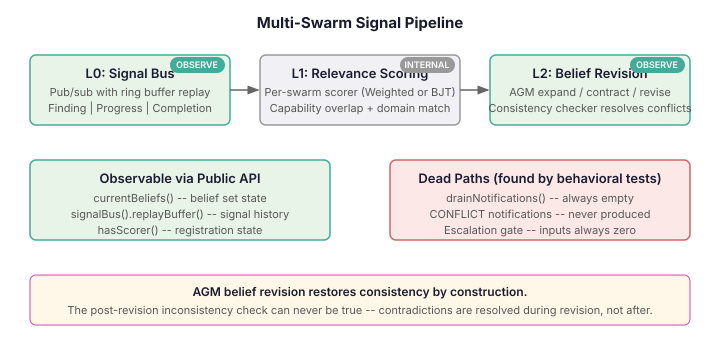
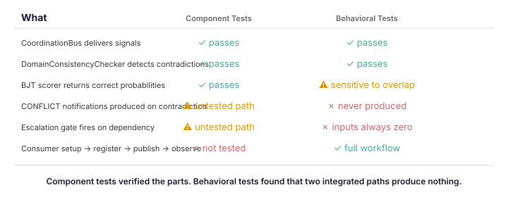

# When All the Tests Pass and Half the System Is Dead

Component tests are seductive. Each one passes. The scorers score. The bus delivers. The consistency checker catches contradictions. You look at the suite — green across the board — and conclude the system works.

Then you write a behavioral test that exercises the consumer workflow end to end, and discover that two entire code paths produce nothing.

## The system under test

Multi-swarm coordination is the layer that sits above individual swarm orchestration. Where a single swarm handles team formation, collective reasoning, and convergence within one group of agents, the multi-swarm layer handles coordination *between* swarms — findings from one investigation that are relevant to another, belief conflicts that span domains, escalation when dependencies tighten.

The architecture is a three-tier pipeline:

**L0** is a signal bus. Swarms publish findings, progress updates, and completion events. Any other swarm can subscribe with a predicate filter. Ring buffer provides cold-start replay for late joiners.

**L1** is relevance scoring. Each swarm has its own scorer — either a weighted linear combination or a Bayesian junction tree (BJT). When a finding arrives, L1 evaluates whether it's relevant to each other swarm based on capability overlap, domain match, signal strength, and historical relevance. Irrelevant signals are filtered here.

**L2** is belief revision. Relevant findings become beliefs in an AGM belief set. When a new belief contradicts an existing one — same entity, different state — formal revision kicks in. The incoming belief always wins; conflicting beliefs with lower entrenchment are contracted. The belief set is always consistent after revision.

Two scoring strategies are available through the builder API: weighted (linear combination, fast, predictable) and BJT (Bayesian junction tree inference, captures conditional independence effects that linear models miss, but sensitive to input distributions).

## What the component tests said

Fifteen test files. The bus delivers signals — tested. The consistency checker catches `node-7:healthy` vs `node-7:degraded` — tested. The BJT scorer returns calibrated probabilities — tested with 22,000 input points across exhaustive sweeps. The weighted scorer's monotonicity — tested. Online learning doesn't degenerate — tested.

Every component works in isolation.

## What the behavioral tests found

I wrote tests that exercise the public API the way a consumer would: build a topology, register swarms, publish signals, read beliefs and notifications. No internal state inspection.

**CONFLICT notifications are dead code.** The system was designed to produce `CrossSwarmNotification` records when contradictory findings arrive. The code checks `!consistencyChecker.isConsistent(updated)` *after* AGM revision — but AGM revision restores consistency by construction. That check can never be true. The contradiction is resolved during `revise()`, not observed afterward.

The component test for `DomainConsistencyChecker` proves the checker can detect contradictions. The component test for `BeliefSet.revise()` proves revision works. Both pass. But the production code that wires them together can never produce the output it was designed for — because it checks consistency *after* the step that guarantees it.

**Escalation gates are inert.** The escalation path checks three inputs: conflict level (derived from pending notification count), resource contention, and dependency strength. Resource contention is hardcoded to `0.0`. Conflict level depends on `pendingNotifications` — which is never populated, because CONFLICT notifications are never produced. Dependency strength alone, even at maximum Jaccard overlap, contributes 0.25 to the weighted score — well below the 0.6 threshold. The gate cannot fire.

**BJT scoring is threshold-sensitive in ways the calibration tests didn't surface.** The adversarial validation suite tests the scorer at capability overlaps of 0.5 and above. In the real topology, the Jaccard overlap between `{analysis, pattern-detection}` and `{remediation, analysis}` is 0.33. At that overlap, with the standard CPT, the BJT scorer produces marginals below the relevance threshold. The scorer works — it returns correct probabilities. But the integrated system doesn't produce beliefs because the signal never passes L1.

## Why this matters

These aren't obscure edge cases. They're the main paths — the designed-for scenarios in the issue specification. A consumer who builds a topology, publishes contradictory findings, and calls `drainNotifications()` gets an empty list. A consumer who publishes progress signals expecting escalation notifications gets nothing.

The component tests created confidence that the parts work. They do. The behavioral tests revealed that the integrated system has dead paths — code that was designed, reviewed, and tested at the component level, but which can never produce its intended output when composed.

The fix for the notification path is straightforward: check consistency *before* revision, not after. The fix for escalation requires either feeding real inputs (conflict level from a working notification system) or reconsidering whether the gate adds value. These are design decisions, not bugs — which is exactly the kind of finding that only surfaces when you test the system as its consumers use it.

Component tests verify that the bricks are solid. Behavioral tests verify that the building stands up.
