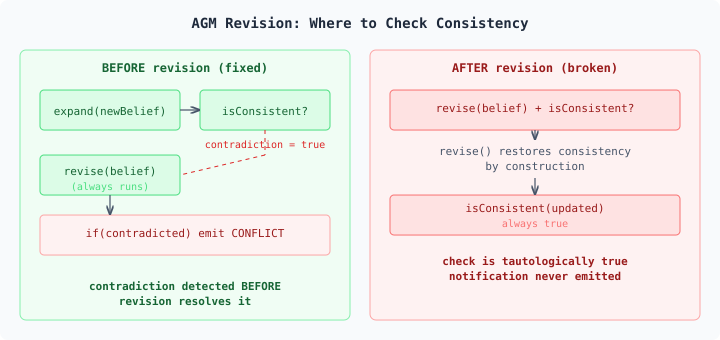
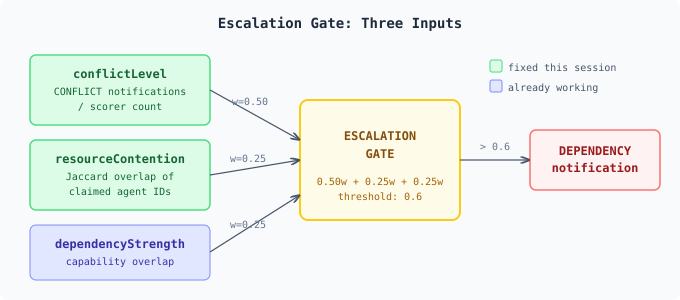

# The Check That Could Never Fail

AGM belief revision has a guarantee that makes it useful: after revision, the belief set is always consistent. You hand it a contradictory belief, and it contracts the weaker one, entrenchment-ordered, until consistency is restored. The output is clean.

That guarantee broke our conflict detection.

## The one-line bug

The multi-swarm topology needs to know when contradictory findings arrive — swarm A says `node-7:healthy`, swarm B says `node-7:degraded`. The system records beliefs via AGM revision and is supposed to emit a `CONFLICT` notification when it detects a contradiction.

The code was:

```java
var updated = beliefSet.updateAndGet(current ->
    current.revise(newBelief, consistencyChecker));

if (!consistencyChecker.isConsistent(updated)) {
    pendingNotifications.add(conflict);
}
```

The check on line 4 is tautologically false. `revise()` guarantees consistency — it contracts contradicting beliefs during revision. Checking after revision is like checking whether a sort function returned an unsorted list. The condition cannot be true by construction.



## Why nobody noticed

The component tests covered both sides independently. `DomainConsistencyChecker` correctly detects structural negation — `node-7:healthy` vs `node-7:degraded`, same entity, different state. `BeliefSet.revise()` correctly contracts weaker beliefs. Both tests pass. The wiring between them is where the logic inverts.

This is a class of bug that doesn't live in any single component. The consistency checker works. The belief set works. The post-revision check is syntactically correct — it calls the right method on the right type. But the *composition* produces dead code, because the property that makes AGM useful (guaranteed consistency) is exactly the property that makes a post-revision consistency check meaningless.

## The fix

Check *before* revision. Use `expand()` — which adds the belief without resolving conflicts — to see if the new belief would create an inconsistency. Then revise unconditionally.

```java
var newBelief = Belief.of(key, conclusion, entrenchment);
boolean contradicted = !consistencyChecker.isConsistent(
    beliefSet.get().expand(newBelief));

beliefSet.updateAndGet(current ->
    current.revise(newBelief, consistencyChecker));

if (contradicted) {
    pendingNotifications.add(conflict);
}
```

`expand()` is the unresolved view — the state where both contradictory beliefs coexist. That's where the contradiction is visible. After revision it's gone, which is exactly what we want for the belief set itself, but not for detection.

## The cascade

Fixing conflict notifications exposed the second dead path: escalation gates.

The escalation gate takes three inputs: conflict level (derived from pending notification count), resource contention, and dependency strength. With notifications never produced, conflict level was always zero. Resource contention was hardcoded to `0.0` — the `ResourceClaim` signal variant existed but its match arm was empty. Dependency strength, computed from Jaccard capability overlap between swarms, maxes out at 0.25 in the weighted formula. Below the 0.6 threshold on its own.



Two of three inputs were permanently zero. The gate couldn't fire regardless of what the system observed.

The fix was mechanical: process `ResourceClaim` signals by tracking which agents each swarm claims, compute contention as the Jaccard overlap of agent sets, and feed it into the gate alongside the now-functional conflict level. One new field, one new method, one line changed in the progress handler.

## The broader pattern

The interesting thing about these bugs is that they're invisible to component testing and to static analysis. The code is type-safe, the methods are called correctly, and every component individually does what it should. What's broken is the *semantic relationship* between steps — a precondition that can't hold, an input that's never populated, a gate whose threshold is unreachable given its actual inputs.

I think of these as composition bugs. They emerge from the interaction between components, not from any single component's behaviour. They survive code review because each line looks correct. They survive component tests because each unit produces correct output for its inputs. They only surface when you test the system as its consumer uses it: build a topology, register swarms, publish contradictory findings, check what comes out.

The fix for the conflict detection was six lines. The fix for the escalation gate was twelve. The behavioral tests that caught them took a day to write. The component tests that missed them have been green for weeks.I
