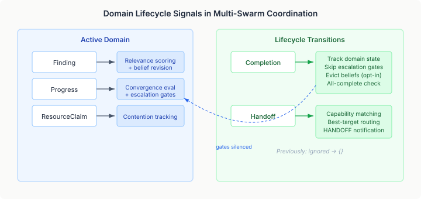

# The Signals Nobody Handled

Multi-agent coordination systems have a blind spot. We spend most of our design budget on the opening act — routing tasks to the right agent, forming teams, negotiating who does what. The coordination bus hums with findings, progress updates, resource claims. Each signal has a handler. Each handler updates state.

But two signals sat in empty match arms, silently discarded:

```java
case MultiSwarmSignal.Completion ignored -> {}
case MultiSwarmSignal.Handoff ignored -> {}
```

The compiler was satisfied. The switch was exhaustive. And when a swarm finished its domain or tried to hand work off to another team, nothing happened.

## Why the endgame matters



The topology was already doing real work with the other signals. When swarm A published a finding, the relevance scorers determined whether swarm B should care. When swarm B reported progress, the escalation gates decided whether the relationship between A and B warranted supervisor attention. Resource claims tracked agent contention across teams.

All of this breaks down at the boundaries. When swarm A completes its domain, it keeps publishing progress — but that progress is now informational, not actionable. The escalation gates keep firing on stale relationships. The belief system keeps revising conclusions about a domain that has reached its final state. And when swarm A has context that swarm B needs, there is no mechanism to route it.

The coordination bus carried the signals faithfully. The type system guaranteed they were handled. But "handled" meant `{}`.

## Completion changes the rules

A completed domain is qualitatively different from an active one. Three things need to change.

**Escalation gates should stop firing.** Progress from a completed swarm is a status report, not a call to action. Before completion tracking, every progress signal triggered the full escalation gate evaluation — conflict level, resource contention, dependency strength — against every other swarm. After a domain completes, that evaluation is waste. The fix is a single early return in the progress handler: if the source swarm has any completed domain, skip the gate loop entirely. Progress still gets recorded. Convergence still gets evaluated. Only the escalation machinery goes quiet.

**Beliefs can optionally be evicted.** The AGM belief revision system tracks conclusions per domain — "node-7:healthy" from swarm A, "node-7:degraded" from swarm B. When swarm A's domain is done, its conclusions are final. Keeping them in the belief set means they can still participate in contradiction detection, which may or may not be desirable. We made this a builder toggle: `evictBeliefsOnCompletion(true)` contracts all beliefs keyed to the completing swarm's domain. The default is off — conservative, because evicting beliefs changes the consistency landscape for every subsequent finding.

**Convergence needs a second path.** The existing convergence evaluator works on progress signals — it watches consensus scores and stability metrics to detect when swarms are converging, deadlocking, or making diminishing returns. But "all domains completed" is a different kind of convergence entirely, orthogonal to progress-based consensus. Rather than extending the evaluator interface across a repo boundary, we added `isAllComplete()` — a simple check that fires when every registered swarm has reported at least one completion. Two paths, two questions: "Are they agreeing?" and "Are they finished?"

## Handoff is routing with context

Handoff is the signal that says: I have done my part, and someone else needs to pick this up. The signal already carried everything needed — a domain name, a context map, and a set of required capabilities. The missing piece was the routing.

The handoff router reuses the same Jaccard overlap that the relevance scorer uses for findings. It matches `requiredCapabilities` against every registered swarm's capability set, picks the best match, and produces a notification:

```java
double overlap = computeCapabilityOverlap(
        handoff.requiredCapabilities(), descriptor.capabilities());
```

Best-match only, not fan-out. A handoff is a transfer to one team, not a broadcast. If no swarm has any capability overlap, no notification is produced — the signal stays in the replay buffer, but nobody acts on it. The consumer can observe that gap and decide what to do about it.

## The pattern worth noticing

The broader lesson here is about exhaustive matching as a false friend. Java's sealed types and pattern matching guarantee that every signal variant has a case. The compiler enforces it. But a case that does nothing is worse than a missing case — a missing case is a compile error you fix immediately. An empty case is a runtime silence you might not notice for months.

The `HANDOFF` enum value existed from day one. The signal records had fields for domain context and required capabilities from day one. The bus delivered them faithfully from day one. But the topology treated them as noise because someone wrote `ignored -> {}` to satisfy the compiler and moved on to the next thing.

Type-level exhaustiveness checks *what you handle*. It cannot check *how well you handle it*. That gap is where coordination systems accumulate technical debt — not in the routing or the team formation, but in the lifecycle transitions that sit at the boundary between "active" and "done."
