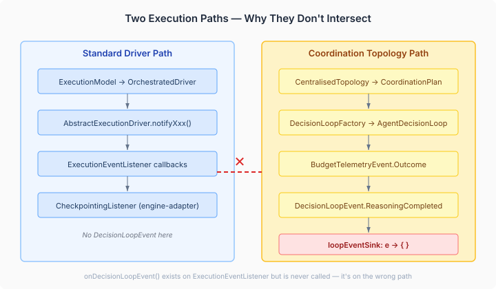
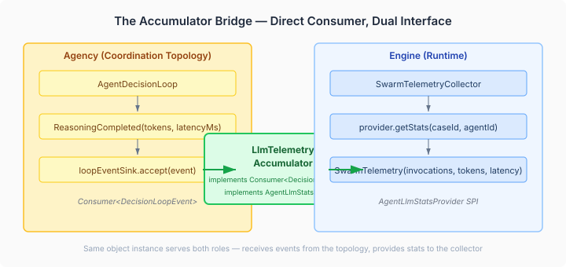

# The Telemetry That Went Nowhere

Every LLM call in CaseHub's coordination topologies emits a `ReasoningCompleted` event carrying the actual token count and latency. Every swarm telemetry snapshot reports those same metrics to coordination listeners. Between the two: a no-op lambda that silently drops the data on the floor.

```java
e -> {});  // loopEventSink — wired at execution layer
```

That comment has been sitting in `SwarmCoordinatorBuilder` since the coordination topology was built. The `loopEventSink` was designed as the conduit for per-agent LLM metrics — token consumption, invocation counts, call latency — flowing from the agency's decision loops into the engine's telemetry system. The engine side was ready too: `SwarmTelemetry` already had `invocationCount`, `tokensConsumed`, and `totalLatency` fields. The collector just passed zeros for all three.

Both ends existed. The pipe between them was a no-op.

## The Obvious Fix That Wasn't

The natural assumption — and the one I started with — was to wire the data through the existing listener architecture. `ExecutionEventListener` already has an `onDecisionLoopEvent()` method, defaulting to no-op. `AbstractExecutionDriver` has the established `notifyXxx` pattern for routing events to listeners. `CheckpointingListener` in the engine-adapter bridges agency events to engine persistence. Wire the sink through the driver, accumulate in the listener, done.

Except the two systems run on different execution paths.



`AbstractExecutionDriver` runs the standard five-phase loop: route → activate → dispatch → aggregate → terminate. It calls `model.listeners()` at each phase boundary — that's how `CheckpointingListener` sees activation counts and agent results.

`DecisionLoopEvent` is emitted from coordination topologies — `CentralisedTopology` → `DecisionLoopFactory` → `AgentDecisionLoop`. This is a separate execution architecture. The topology creates per-agent decision loops with their own observation pipelines, budget governance, and degradation triggers. The driver never sees inside these loops. It dispatches agents and collects results — what happens during an agent's reasoning is opaque to it.

The `onDecisionLoopEvent()` method on `ExecutionEventListener` exists but nothing calls it. It was placed there anticipating a wiring that can't work with the current architecture — the driver and the topology don't share an execution boundary where the handoff could happen.

## Respecting Execution Path Boundaries

Once you see the two paths clearly, the fix is simpler than the intended design. The `loopEventSink` is a `Consumer<DecisionLoopEvent>` captured at topology construction time. It needs a concrete consumer, not a delegation chain through a driver that never runs in this context.



`LlmTelemetryAccumulator` implements both sides of the contract. As a `Consumer<DecisionLoopEvent>`, it plugs directly into the topology's `loopEventSink` — no driver middleware, no listener chain. As an `AgentLlmStatsProvider` (a new engine SPI), it exposes the accumulated stats to `SwarmTelemetryCollector` through the same query pattern the collector already uses for work counters.

```java
public class LlmTelemetryAccumulator
        implements Consumer<DecisionLoopEvent>, AgentLlmStatsProvider {

    @Override
    public void accept(DecisionLoopEvent event) {
        if (event instanceof DecisionLoopEvent.ReasoningCompleted rc) {
            accumulators.computeIfAbsent(rc.agentId(), k -> new LlmAccumulator())
                        .record(rc.tokensConsumed(), rc.latencyMs());
        }
    }

    @Override
    public AgentLlmStats getStats(UUID caseId, String agentId) {
        var acc = accumulators.get(agentId);
        if (acc == null) return AgentLlmStats.ZERO;
        return new AgentLlmStats(acc.invocationCount, acc.tokensConsumed,
                Duration.ofMillis(acc.totalLatencyMs));
    }
}
```

The same object instance serves as both the event sink and the stats provider. The caller creates it, passes it to the topology builder as the `loopEventSink`, and passes it to the telemetry collector as the `AgentLlmStatsProvider`. No intermediate layers, no event translation, no delegation chains through architectures that don't participate.

## Why This Matters Beyond the Wiring

Multi-agent coordination without per-agent cost visibility is governance theatre. You can set budget limits, enforce token caps, and implement pressure-based degradation — and we do all of that — but if the telemetry snapshots that inform provisioning and coordination decisions report zero tokens consumed, every downstream decision operates on fiction.

`SwarmProvisioningAdvisor` uses telemetry snapshots to decide when to scale the swarm. `SwarmConvergenceTermination` uses them to evaluate whether the swarm has stabilised. Both were receiving `invocationCount: 0, tokensConsumed: 0, totalLatency: ZERO` for every agent, every cycle, regardless of actual LLM activity. The budget system was counting (after the fix in `BudgetAwareSummariser`), but the coordination layer couldn't see the counts.

With the bridge in place, telemetry snapshots carry real data. An agent that's consumed 3,000 tokens across 5 invocations with 800ms total latency now reports those numbers to every coordination listener — provisioning advisors, convergence evaluators, and any future component that needs per-agent cost attribution.

## The Broader Pattern

The lesson isn't specific to telemetry. Any time two subsystems with different execution models need to exchange data, the bridge must respect execution path boundaries — not assume shared infrastructure that doesn't exist. A comment saying "wired at execution layer" is an aspiration, not an architecture. The execution layer it imagined — one where the driver forwards events from inside topology decision loops — doesn't exist because the driver and the topology operate at different granularities. The driver dispatches agents. The topology runs the reasoning that happens after dispatch. Different lifecycles, different call stacks, different ownership.

The fix in every case is the same: find the actual boundary where data crosses layers, and put the bridge there. Not where the architecture diagram says it should go. Where the code actually runs.
