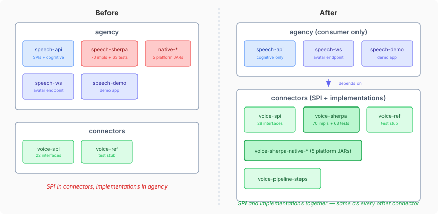

# The Code That Lived in the Wrong Repo

Every platform SPI in connectors follows the same pattern: the SPI defines the
capability contract, provider modules implement it, and consumers use it through
the SPI without coupling to a specific provider. Chat has `chat-spi` with Slack,
Discord, and Signal implementations alongside. Email has `email-spi` with Google
Mail. Calendar, banking, commerce, documents — all the same shape. Provider
contract and provider implementations in the same repo, every time.

Voice was the exception.

The `VoicePlatform` SPI lived in connectors where it belonged — `SpeechToText`,
`TextToSpeech`, `PhonemeAligner`, twenty-two interfaces defining what a voice
provider must do. But the code that actually *did* the work — Kokoro TTS,
Whisper STT, sherpa-onnx native bindings, ONNX Runtime, espeak phonemization,
grammar correction, speaker diarization — all of it lived in agency's
`speech-sherpa` module. Seventy implementation files and sixty-three test files,
plus five platform-specific native library JARs, in the wrong repo.

This matters beyond tidiness. Any CaseHub application that needed real voice —
not the test stub, real Kokoro or Whisper — had to depend on agency. Agency is
a heavyweight dependency: it pulls in the orchestration framework, the
deliberation protocols, the summarisation pipeline, the cognitive subsystem.
If you just want text-to-speech for a notification service, you should not need
the entire multi-agent reasoning stack on your classpath.

## What connectors actually is

The framing matters here. Connectors is not a "channel layer" or a "transport
tier." It is a generalised third-party plugin system. Each SPI defines a
capability boundary — voice, chat, email, banking, location — and each provider
module implements that boundary for a specific third party. Kokoro, Vits, and
Whisper are third-party voice engines the same way Slack and Gmail are
third-party communication platforms. They belong in connectors for the same
reason.

Agency, by contrast, is the consumer. The avatar WebSocket endpoint in
`speech-ws` is how agents *use* voice to interact with humans. It is not a
voice provider. The distinction: connectors owns the engines; agency owns the
experience.

## The migration

Claude and I moved 133 Java files (70 source, 63 test), all test resources,
native build scripts, and five platform-specific native library modules from
agency to connectors. IntelliJ's refactoring engine handled the cross-project
moves within a shared workspace — package declarations, imports, and references
updated across both repos in a single operation per file. No manual
find-and-replace.

Six voice infrastructure SPIs that were stuck in agency's `speech-api` —
`TextFilter`, `CleanupConfig`, `CorrectionStrategy`, `SpeakerDiarizationService`,
`DiarizedSegment`, `DiarizationOptions` — moved to connectors `voice-spi` where
the implementations needed them.

The implementations already implemented connectors interfaces. `KokoroTextToSpeech`
already `implements TextToSpeech` from `io.casehub.connectors.voice.spi`. The
migration was completing a move that was architecturally decided but physically
unfinished — the interfaces had crossed the boundary, the code behind them
hadn't followed.

After the move: 498 tests pass in connectors `voice-sherpa`. Agency's
`speech-ws` (117 tests), `agentic-yaml` (410 tests), and `speech-demo` all
compile and pass against the connectors dependency. Agency no longer contains
any voice implementation code.

## What stays in agency

The avatar WebSocket endpoint stays — it is the agent-side consumer of voice,
not a provider. `speech-api` retains the cognitive types that describe how an
agent reasons about a conversation: `AvatarCognition`, `SpeechPromptAssembler`,
`AssembledPrompt`. These are about prompt construction and cognitive tick
cycles, not about audio processing. (Whether they ultimately belong in
neocortex rather than agency is a separate question we've filed for later.)

## The principle underneath

When an SPI and its implementations live in different repos, the boundary is
lying. The SPI says "this is a pluggable capability" but the implementation
coupling says "you actually need this specific repo." Every consumer ends up
depending on the implementation repo transitively, and the SPI boundary becomes
a fiction.

Fixing this for voice follows a pattern we've applied repeatedly across the
platform: extract shared patterns to where they belong, then let consumers
depend only on the contract. The orchestration framework, the conversation
protocol, the summarisation pipeline — all of these went through similar
boundary corrections. Voice was the last holdout.

The next move is the cognitive code still in agency that should be in neocortex.
Same principle, different boundary.
