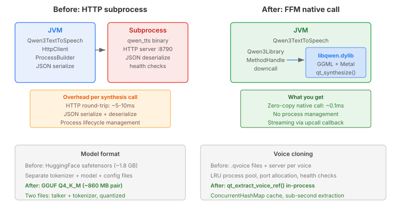

# The Five Milliseconds Nobody Notices

The Qwen3-TTS integration worked. You typed text, audio came back, the avatar
spoke. Every synthesis call went through an HTTP server running as a
subprocess — Java started the binary, polled a health endpoint until it
answered, serialised a JSON request, posted it over localhost, read the
response body, and wrapped the PCM bytes as WAV. For voice cloning, each
cloned voice got its own server process on a dedicated port, managed by an
LRU pool that started and killed OS processes as voices rotated.

It worked. Five to ten milliseconds of HTTP overhead per call, invisible
against the hundreds of milliseconds the model itself takes to synthesise
speech. Nobody would look at a flame graph and point at the HTTP round-trip
as the problem.

The problem was everything around it.

Process management is where the complexity lived. Start the binary, wait up
to thirty seconds for the health check to pass, capture stdout on a virtual
thread so server logs don't block, handle the case where the process dies
mid-synthesis, destroy the process on close with a five-second timeout,
forcibly kill it if it doesn't cooperate. For the voice pool: track which
ports are allocated, which processes are alive, evict the least-recently-used
voice when the pool is full, restart a server if it crashes between calls.
Over a hundred lines of `ProcessBuilder`, `HttpClient`, and LRU bookkeeping
to do what is, at its core, a function call: here is text, give me audio.



## Panama makes it a function call

Java 22 shipped the Foreign Function and Memory API as a stable feature.
FFM lets you load a shared library, look up a symbol, and call it — no JNI
boilerplate, no generated header files, no native compilation step. A
`MethodHandle` downcall is the Java equivalent of a C function pointer: you
describe the signature with a `FunctionDescriptor`, the linker gives you a
handle, and you invoke it.

The pattern we've used for sherpa-onnx, onnxruntime, and espeak-ng is
always the same. A singleton library class loads the `.so` / `.dylib` /
`.dll` via three-tier resolution — system library path, local cache, or
auto-download from a GitHub release. The constructor resolves every symbol
into a `MethodHandle` field. Callers allocate a confined `Arena`, fill a
zero-initialised struct with the fields they need, invoke the handle, read
the output struct, and the arena frees everything when it closes.

```java
try (Arena arena = Arena.ofConfined()) {
    MemorySegment params = arena.allocate(Qwen3Layouts.TTS_PARAMS_SIZE);
    params.fill((byte) 0);
    lib.ttsDefaultParams.invokeExact(params);
    params.set(ADDRESS, Qwen3Layouts.TTS_TEXT, arena.allocateFrom(text));
    params.set(ADDRESS, Qwen3Layouts.TTS_LANG, arena.allocateFrom("english"));

    MemorySegment audio = arena.allocate(Qwen3Layouts.AUDIO_SIZE);
    int status = (int) lib.synthesize.invokeExact(context, params, audio);
    // ... read samples from audio struct, encode as WAV
}
```

That's the entire synthesis path. No HTTP client, no JSON serialisation,
no process lifecycle. The C library runs in-process, on the same thread,
with zero-copy access to its output buffer. The `Arena` scope guarantees
that every native allocation is freed when the try block ends — no manual
`free()` calls to forget.

## Streaming through the C ABI

The part that surprised me was streaming. I assumed qwentts.cpp would need
a separate `qt_synthesize_streaming` function — that's how I'd have
designed it, and it's what the initial plan proposed. The actual API is
more elegant: a single `qt_synthesize` function with an optional callback
field in the params struct.

```c
typedef bool (*qt_audio_chunk_cb)(const float *samples, int n_samples,
                                  void *user_data);

struct qt_tts_params {
    // ... text, lang, sampling params ...
    qt_audio_chunk_cb on_chunk;
    void *            on_chunk_user_data;
};
```

Set `on_chunk` to a function pointer and `qt_synthesize` switches to
streaming mode — audio chunks emit through the callback as they're
decoded, and the output buffer stays empty. Leave it NULL and you get the
buffered result in the output struct. Same function, same params, one
field controls the mode.

In Java, the callback becomes an FFM upcall stub — a `MemorySegment` that
the native code can call as a C function pointer, which routes back to a
Java method. The critical detail: if the Java callback throws an exception,
that exception unwinds through C stack frames that have no exception
handlers. The JVM crashes. So the upcall stub catches everything, stores
the exception in a holder, returns normally to the native code, and
rethrows after `qt_synthesize` returns.

## What vanished

The `Qwen3TextToSpeech` class went from HTTP client, process builder, JSON
serialisation, health-check polling, and WAV chunk assembly over a network
stream — to nine `MethodHandle` fields and struct-level read/write
operations. The `Qwen3VoicePool` went from an LRU process pool with port
allocation, process lifecycle management, and per-voice HTTP servers — to
a `ConcurrentHashMap` of extracted voice references. Voice cloning is now
a call to `qt_extract_voice_ref` that reads a WAV file and returns a
speaker embedding in under a second, cached for reuse.

The model format changed too. The HTTP server consumed HuggingFace
safetensors — multiple files, full precision, ~1.8 GB. The native library
uses GGUF — two files (talker + tokenizer), quantised to Q4_K_M, ~860 MB
for the pair. Smaller download, faster load, and the GGML runtime handles
Metal acceleration on Apple Silicon without any Java-side GPU
configuration.

## When this pattern applies

FFM isn't always the right answer. The HTTP subprocess approach has a
property that FFM sacrifices: crash isolation. If the TTS server segfaults
on a malformed input, the Java process survives. With FFM, a native crash
takes down the JVM — every other TTS engine, every STT session, the entire
application.

For battle-tested libraries — sherpa-onnx with its extensive fuzzing,
onnxruntime with its corporate backing — that trade-off is easy. For a
younger library like qwentts.cpp, it's a bet on the maturity of the GGML
ecosystem. GGML powers llama.cpp and whisper.cpp; the inference codepath is
heavily exercised across hundreds of models and millions of users. The
qwentts.cpp layer on top is thinner than it looks — most of the
complexity lives in GGML.

The pattern applies when: the library has a clean C ABI (not C++ with
name mangling), the call overhead matters less than the process management
overhead, and you're willing to share the JVM's fate with the native code.
When those hold, FFM turns what was an integration project into a
binding — and a binding is just a list of function signatures.
