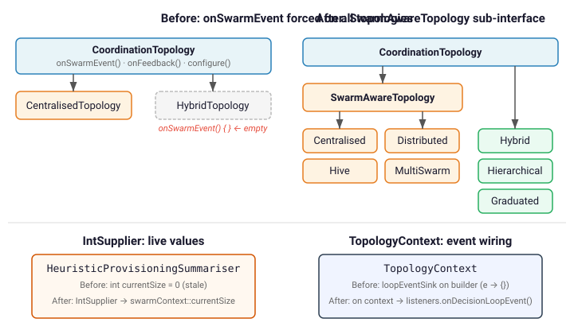

# The Coupling That Wasn't Visible

Two weeks ago a code review flagged something I'd walked past: five of six topology implementations had empty `onSwarmEvent()` methods. The interface was forcing a swarm-specific contract on topologies that have nothing to do with swarms. Classic ISP violation, filed it, moved on to other work.

Today I came back to fix it, and found three related problems living in the same neighbourhood. Each was small. Together, they told a story about how coupling accumulates when the first version of a thing works well enough that nobody questions where the boundaries are.

## The provisioning heuristic that couldn't see

`HeuristicProvisioningSummariser` takes the current swarm size and max size, compares them, and advises whether to provision more agents. Simple. But it captured those values as `int` fields at construction time:

```java
public HeuristicProvisioningSummariser(SwarmFallbackStrategy fallback,
                                       int currentSize, int maxSize) {
```

The builder passed `(0, 10)` — hardcoded. `SwarmContext` already tracked live values via `ProvisioningChanged` events, updated by `volatile` fields. The heuristic just couldn't see them because it took a snapshot before the swarm existed.

The fix is a one-word change to the type system: `IntSupplier`. The heuristic calls `currentSize.getAsInt()` on every invocation. The builder wires `swarmContext::currentSize`. The same volatile reads that were always thread-safe now flow through to the decision point.

This is a pattern worth internalising. When a component takes configuration that could change over time, the question isn't "will it change?" — it's "who controls when it's read?" An `int` field says "the caller decided at construction." An `IntSupplier` says "the source decides at call time." The topology layer already had the live data. The heuristic just wasn't asking for it.

## The event pipeline with nowhere to go

The decision loop fires `DecisionLoopEvent` variants — reasoning started, reasoning completed, budget exhausted, degraded. `MetricsListener.onDecisionLoopEvent()` records them as OpenTelemetry metrics. The plumbing was complete: the factory bridges budget telemetry to loop events, the loop emits observation events, `MetricsListener` has the switch statement ready to dispatch.

But the `Consumer<DecisionLoopEvent>` that connects producer to consumer was `e -> {}`. A no-op lambda, sitting on the builder, never wired to anything.

The problem was ownership. The builder creates the topology. The execution layer holds the listeners. The builder doesn't know about listeners. The topology takes the sink at construction, before the execution layer has had a chance to provide it.

I moved the sink to `TopologyContext` — the execution layer's handoff to the topology. `TopologyContext` already carries `AgentProvider`, `DecisionLoopFactory`, `AutonomyBudgetPolicy`, `DegradationPolicy`. The loop event sink belongs with the same crowd: execution-layer concerns that the topology needs at configure time, not at construction time. `CentralisedTopology.configure()` now reads `context.loopEventSinkOrDefault()` — a one-line local variable, null-safe, no constructor change needed.

The `loopEventSinkOrDefault()` helper is worth noting. Rather than force every topology context constructor to pass a sink, the method returns a no-op fallback when the field is null. The execution layer wires it when it has listeners. Topologies that don't care never see it.

## The interface that lied about its scope



Back to the original finding. `CoordinationTopology` declared `onSwarmEvent(SwarmCoordinationEvent)` as an abstract method. Every implementation had to provide it. Three of them — `HybridTopology`, `HierarchicalTopology`, `GraduatedTopology` — provided empty bodies. The obligation was real; the value was zero.

I brought Claude in to audit which topologies actually use swarm events before making the extraction. The original assumption was that only `CentralisedTopology` needed it. Claude read all seven implementations and came back with a correction: four topologies have real swarm event logic, not one.

`HiveTopology` handles `RoleChanged` events for role bridging — mapping detected roles to strategy suggestions. `DistributedTopology` converts swarm events to observation events and routes them to per-agent loops. `MultiSwarmTopology` looks up swarm descriptors and publishes coordination signals. These aren't swarm-specific topologies in the narrow sense, but they respond to swarm lifecycle events in meaningful ways.

The extraction is a new `SwarmAwareTopology` interface that extends `CoordinationTopology` and adds `onSwarmEvent()`. Four implementations implement it. Three don't. No existing test changed behaviour — the method was already there, it just moved to a narrower type.

## What connects these three

Each fix was small — an `IntSupplier`, a field on a record, a sub-interface. None required more than a few lines of production code. But they share a pattern: coupling that arrives with the first working version and stays because nothing breaks.

The provisioning heuristic worked. It just always advised "provision more" because the stale snapshot said size was zero. Nobody noticed because the LLM-backed provisioning advisor runs first, and the heuristic is a fallback for when the LLM is unavailable.

The event pipeline worked. It just dropped every event into a void. Nobody noticed because the metrics dashboard didn't have panels for loop-level telemetry yet.

The interface worked. It just made every new topology author write `public void onSwarmEvent(SwarmCoordinationEvent event) {}` and move on. Nobody noticed because the empty method compiles and doesn't affect correctness.

Coupling that doesn't cause failures is the kind that accumulates. Each instance is too small to trigger a design review. But the aggregate effect is a topology layer that implicitly assumes every topology is a swarm, every component was configured correctly at construction, and every event has somewhere to go. The code review two weeks ago didn't find bugs — it found assumptions.
