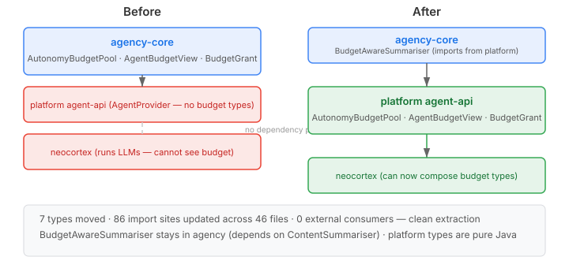

# The Data That Wasn't There

Every agent invocation in the autonomy budget system fires a `BudgetTelemetryEvent.Outcome` recording the model, tokens consumed, and latency. The telemetry pipeline is complete — acquisition events pair with outcomes, correlation IDs link them, and `MetricsListener` is wired up to record everything. The data looks correct until you notice every outcome reports zero tokens.

The token estimator was `r -> 0L`. A no-op lambda, passed at construction, never replaced.

This had been there since the budget system shipped. It compiled. It didn't throw. The telemetry events fired with the right structure — just the wrong numbers. Any dashboard built on this data would show budget pressure as a function of call count alone, never token consumption. For an advisory budget system that's supposed to signal when LLM costs are approaching limits, reporting zero tokens is worse than reporting nothing — it's actively misleading.

## Why the data was missing

`BudgetAwareSummariser` wraps a delegate `ContentSummariser` and gates it behind a budget check. After the delegate returns, it calls a `ToLongFunction<R>` to estimate how many tokens were consumed, then records them against the agent's budget view. The problem: `DecisionOutcome` — the delegate's return type — didn't carry token information. The LLM invocation happens inside `DistributedAgentReasoner`, which calls `StructuredAgentInvoker.invokeRaw()` and gets back an `InvocationResult` with full metadata: input tokens, output tokens, thinking tokens, cache reads, duration. But the reasoner extracted the parsed JSON and threw the metadata away.

The fix threads the data through. `WriteBack` — the most common `DecisionOutcome` variant, the one produced by LLM calls — now carries `estimatedOutputTokens` as a fourth component:

```java
record WriteBack(
    List<Observation> observations,
    List<SignalDeposit> signals,
    List<ContextWrite> contextWrites,
    long estimatedOutputTokens
) implements DecisionOutcome {
    // backward-compatible 3-arg constructor defaults to 0L
    public WriteBack(List<Observation> observations, ...) {
        this(observations, signals, contextWrites, 0L);
    }
}
```

The 3-arg constructor preserves backward compatibility — dozens of test sites construct `WriteBack` with empty lists, and none of them care about token counts. The reasoner now passes `s.metadata().outputTokens()` from the invocation result. The token estimator in the factory extracts it via pattern matching, recursing through `Composite` and `ScopeGated` wrappers.

## The placement question

The token fix was straightforward, but it surfaced a bigger question. The budget types — `AutonomyBudgetPool`, `AgentBudgetView`, `BudgetPressure`, `BudgetGrant`, `BudgetPriority`, `AutonomyBudgetPolicy`, `BudgetTelemetryEvent` — lived in `agency-core`. They had zero agency dependencies: just `java.util`, `java.time`, and `org.jspecify`. Pure value types with no LLM logic, no summarisation dependencies, nothing that required agency's APIs.

Meanwhile, `AgentProvider` lives in `platform/agent-api`. Connection pooling and rate limiting live there. These are the LLM access types — the things every layer that calls an LLM depends on. Budget pools are the cost-accounting counterpart. If you're tracking how much an LLM call costs, you need the same visibility as whoever makes the call.



Neocortex runs LLMs for embeddings, retrieval, and memory operations. It depends on platform for `AgentProvider`. It does not depend on agency — and shouldn't, since agency is a higher-level orchestration layer. With budget types trapped in agency, neocortex couldn't track its own LLM costs through the same pool infrastructure. Enterprise cost dashboards would see agency's spend and nothing else.

I brought Claude in to audit all 26 sibling repos for external consumers of the budget package before making the move. Zero hits — the types were agency-internal. The extraction was clean: seven files moved, 86 import sites updated across 46 files, platform tests copied and passing.

## The cascade boilerplate

A third piece fell out of the same session. Five of the six topology implementations duplicate identical cascade-tracking logic in their `onDegradation()` handlers — a `ConcurrentHashMap.newKeySet()` for degraded loops, an `AtomicBoolean` for the one-shot trigger, a threshold check, and cascade trigger activation. Fifteen lines, copy-pasted, with only the response body differing between topologies. `CentralisedTopology` activates cascade triggers. `HiveTopology` downgrades its orchestration pattern first. `GraduatedTopology` forces all agents to stimulus-driven scope.

I extracted the common tracking into a `CascadeHandler` that takes a `Runnable` for the topology-specific response. The handler runs the action, then activates the cascade triggers — matching the existing order. Future topology authors compose this instead of rediscovering the boilerplate. The five existing topologies still have their inline versions — migrating them is a separate cleanup that touches constructors and test wiring.

## The invisible defaults

What connects these three: a no-op lambda reporting zero tokens, budget types placed one layer too high, and cascade logic copy-pasted across five files. None caused failures. Each worked well enough that the original code shipped, tests passed, and the system operated correctly — in the narrow sense that nothing crashed.

But "doesn't crash" is not the same as "tells the truth." A telemetry event that reports zero tokens tells a lie with correct structure. A budget type in the wrong layer draws an invisible boundary that prevents legitimate composition. Cascade boilerplate in five files hides the pattern from anyone who hasn't read all five.

The pattern is worth watching for: defaults that satisfy the compiler but mislead the reader. `r -> 0L` is the most literal version — a function that returns a plausible-looking value that happens to be wrong. But the placement of types in a dependency graph is the same kind of default. It compiled there first. It stayed because nothing broke.
