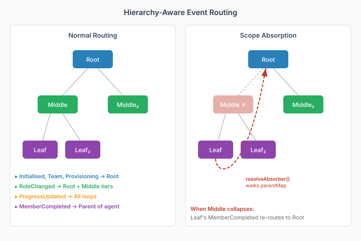

# The Hierarchy That Couldn't Hear

`HierarchicalTopology` could build a tree of agents — root coordinators, mid-level managers, leaf workers — but it had no ears. Swarm events arrived and hit a wall: the class implemented `CoordinationTopology`, not `SwarmAwareTopology`. Every other topology (Centralised, Distributed, Hive, MultiSwarm) could react when a member completed or the team changed. The hierarchy couldn't.

This matters because a hierarchy is precisely the topology where routing decisions are most interesting. A flat swarm broadcasts everything to everyone. A centralised coordinator has three named loops and a lookup table. A hierarchy has to answer: who needs to know *this particular thing*, given their position in the tree?

## Routing by role, not by name

The answer falls out of the hierarchy's own structure. Strategic events — initialisation, team formation, provisioning changes — go to the root. Only the root has FULL_AUTONOMY scope and the authority to reshape the swarm. Role changes go to every non-leaf node: the root and the mid-level managers who might need to restructure their sub-teams. Progress updates broadcast to everyone — awareness is universal. And when a member completes, the event goes to that agent's parent. Not the root. Not the whole tree. The supervisor who assigned the work.

```java
case SwarmCoordinationEvent.MemberCompleted e -> {
    String parent = parentMap.get(e.agentId());
    if (parent != null) {
        feedLoop(resolveAbsorber(parent), ObservationEvent.of("member-completed", e));
    }
}
```

The `parentMap` that defined the hierarchy at construction time becomes the routing table at runtime. No separate routing configuration, no event taxonomy to maintain. The shape of the hierarchy *is* the routing policy.

## The part that earns its keep: scope absorption

Event routing alone would justify the work, but the more interesting infrastructure is what happens when a child collapses. In a flat topology, degradation is local — a loop switches to heuristic fallback and continues. In a hierarchy, collapse creates a gap: a mid-level manager that can no longer process events means its children's work has nowhere to report.

Scope absorption fills that gap. When `onDegradation` fires for a loop, its name goes into a `collapsedLoops` set. Every targeted event delivery now passes through `resolveAbsorber()`, which walks up the `parentMap` looking for a non-collapsed ancestor:

```java
private String resolveAbsorber(String agentId) {
    String current = agentId;
    while (collapsedLoops.contains("hierarchical-" + current)) {
        String parent = parentMap.get(current);
        if (parent == null) break;
        current = parent;
    }
    return current;
}
```

If a middle manager collapses, its children's completion events redirect to the root. If both a manager and its parent collapse, the walk continues up. The same parentMap that defines the tree at build time defines the fallback chain at failure time.



## What we deliberately left out

The current implementation treats every degradation as a collapse — if `fallbackActive` is true, the loop is immediately absorbed. In practice, there's a gradient: a temporary latency spike that triggers heuristic fallback is not the same as a loop that can no longer function. Separating degradation from collapse needs a more nuanced trigger — probably a sustained-duration threshold or an explicit failure signal from the loop itself. We filed that as a separate issue rather than complicate the first version.

Similarly, the broadcast path (ProgressUpdated to all loops) doesn't participate in absorption. It still delivers to collapsed loops. That's defensible — the parent already receives the broadcast, so no information is lost — but it's inconsistent with the targeted routing model. Worth revisiting once we see how consumers actually use the broadcast events.

## The pattern worth noticing

The reusable insight here isn't specific to agent hierarchies. Any system with a tree-shaped authority structure needs the same three things: role-based event routing (who cares about what), a registered-loop pattern for external wiring (the topology doesn't own loop creation), and a fallback chain for when nodes fail (re-route, don't drop). The `parentMap` serves all three purposes because the hierarchy *is* the routing policy, the supervision structure, and the failure recovery path. That's not a coincidence — it's why hierarchies exist.
