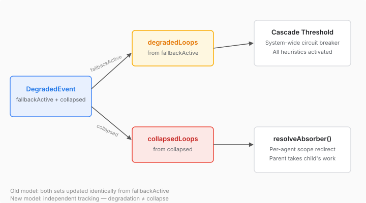

# Not Every Stumble Is a Fall

When we built the degradation system, every failure looked the same. An agent's LLM call breached the latency threshold? The topology immediately absorbed its scope into the parent. Budget exhausted? Same thing — parent takes over. The agent was effectively dead to the hierarchy from the moment a single trigger fired.

This was the simplest model that could work, and it did work. But it conflated two things that are operationally different: an agent running on heuristics and an agent that cannot function at all.

## The distinction

A degraded agent is still doing its job. It switched from LLM-backed reasoning to a heuristic fallback — cruder decisions, but decisions nonetheless. It routes candidates by selecting all of them instead of reasoning about fit. It aggregates results by concatenation instead of synthesis. The quality drops. The agent keeps functioning.

A collapsed agent is structurally absent. Its decision loop has failed in a way that heuristics cannot compensate for — sustained degradation across multiple calls, or an explicit failure signal from the infrastructure. The parent must absorb its scope because nobody else is handling that work.

The old model treated both cases identically: any degradation immediately triggered scope absorption. A latency spike on a single call caused the parent to take over all routing that the child was responsible for. The child's loop kept running (and might recover on the very next tick), but its scope had already been redistributed.

## Graduated response

The fix separates the tracking into two independent sets. `degradedLoops` feeds the cascade threshold — it determines when enough agents have degraded to trigger a system-wide structural response. `collapsedLoops` feeds the scope absorber — it determines which agents' work gets redirected to their parent.

The key change is in the event model. `DegradedEvent` now carries a `collapsed` flag alongside the existing `fallbackActive`. Degradation sets `fallbackActive`; collapse requires explicit `collapsed=true`. The emitter decides which level applies — the topology just reacts to what it's told.

```java
public record DegradedEvent(String capability, String reason,
                            boolean fallbackActive, boolean collapsed) {
    public DegradedEvent(String capability, String reason,
                         boolean fallbackActive) {
        this(capability, reason, fallbackActive, false);
    }
}
```

The backward-compatible three-argument constructor means every existing emitter gets degradation-only semantics by default. Scope absorption is opt-in.

## The broadcast gap

Separating degradation from collapse exposed a second inconsistency. Every targeted event in the hierarchy — `MemberCompleted`, `RoleChanged` — routed through `resolveAbsorber()`, which walks up the parent chain past collapsed agents. But `ProgressUpdated` broadcast directly to every registered loop, including collapsed ones.

A collapsed agent receiving a progress update is at best pointless (the agent can't act on it) and at worst confusing (the absorbing parent also receives the broadcast, so the information arrives twice but through different paths). The fix routes all broadcasts through the same absorption-aware dispatch that every other event path uses.



## Why this matters in practice

The practical difference is stability. Under the old model, a transient latency spike in a leaf agent caused an immediate cascade of scope redistribution up the hierarchy. The root agent suddenly had responsibilities it wasn't expecting. When the leaf recovered a few ticks later, its scope had already moved — and moving it back would require another round of redistribution.

With graduated response, a latency spike triggers heuristic fallback but scope stays put. The agent keeps doing its job, just with less intelligence. If the problem is transient, nothing else in the hierarchy notices. If it sustains — that's when the topology needs to respond structurally, and the emitter signals collapse.

The cascade threshold still fires based on degradation count, not collapse. When enough agents are on heuristics, the topology takes structural action regardless of whether individual agents have collapsed. The two signals serve different purposes: cascade is a system-wide circuit breaker; collapse is per-agent scope redistribution.

This is the same principle behind every tiered alerting system. A warning is not a page. A retry is not a failover. Treating them identically means you either over-react to transient problems or under-react to real ones.
