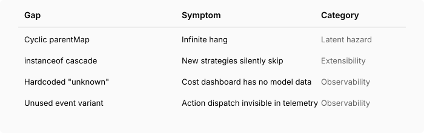

# The Gaps That Tests Don't Find

Four things went wrong in the same subsystem this week. All four passed every test. All four compiled. All four ran in production without incident. And all four were broken — just not in a way that shows up in a stack trace.

The subsystem is the decision loop infrastructure in CaseHub's orchestration layer. It's the machinery that creates per-agent reasoning loops inside coordination topologies — budget-gated, degradation-aware, with event telemetry for every decision. The kind of code that has to be correct at the edges, not just the centre, because the edges are where you lose visibility.

## The cycle nobody triggered

`HierarchicalTopology` takes a `parentMap` — a tree of agent-to-parent relationships that determines depth, role assignment, and event routing. The map is `Map.copyOf`'d at construction time, so it's immutable from that point. But `computeDepth()` and `resolveAbsorber()` both walk the parent chain in a while loop. If the map contains a cycle — A→B→A — those loops never terminate.

The risk is low. The map is typically constructed from a consistent agent set and nobody has shipped a cyclic one. But "nobody has done it yet" is not a safety argument — it's a countdown. The fix is a one-time validation at construction:

```java
private static void validateAcyclic(Map<String, String> parentMap) {
    for (String start : parentMap.keySet()) {
        Set<String> visited = new HashSet<>();
        visited.add(start);
        String current = parentMap.get(start);
        while (current != null) {
            if (!visited.add(current)) {
                throw new IllegalArgumentException(
                    "Cycle detected in parentMap involving: " + current);
            }
            current = parentMap.get(current);
        }
    }
}
```

Cheap. Runs once. Fail fast with a clear message instead of hanging forever. The kind of check that never fires — until it saves someone an hour of debugging.

## The instanceof that couldn't extend

`CentralisedTopology.configure()` wires token recording into LLM-consuming strategies so budget telemetry can track cost per concern. The wiring looked like this:

```java
if (routingStrategy instanceof SwarmRoutingStrategy srs) {
    srs.setTokenRecorder(t -> pool.recordTokens("routing", t));
}
if (aggregationStrategy instanceof CollectiveReasoningAggregation cra) {
    cra.setTokenRecorder(t -> pool.recordTokens("aggregation", t));
}
// ... and a third for provisioning
```

Three concrete instanceof checks. Any new strategy that consumes tokens and doesn't get a branch here silently skips recording. You would only discover this when someone notices the cost dashboard has gaps.

The fix is the textbook extract-interface refactoring: a `TokenRecordable` interface with `setTokenRecorder(LongConsumer)`, implemented by the three strategies, checked once:

```java
private static void wireTokenRecorder(
        Object target, String label, AutonomyBudgetPool pool) {
    if (target instanceof TokenRecordable tr) {
        tr.setTokenRecorder(t -> pool.recordTokens(label, t));
    }
}
```

New strategies just implement the interface. The topology doesn't need to know they exist.

## The model ID that was always "unknown"

`DecisionLoopFactory` creates `BudgetAwareSummariser` wrappers that emit telemetry events on every LLM invocation. Those events include a `modelId` field. The factory was passing `"unknown"`.

This means every `BudgetTelemetryEvent.Outcome` in the system carried `modelId: "unknown"`. Cost attribution per model? Impossible. The field was there. The event was there. The subscriber was there. The data was always missing.

The fix threads the model identifier through the factory constructor. Callers that know their model pass it; the two-arg convenience constructor defaults to `"unknown"` so nothing breaks. One field, one constructor parameter, one line changed in the factory's create method.

## The event that was never emitted

`DecisionLoopEvent.ActionDispatched` was defined — a record with `caseId`, `agentId`, `outcomeType`, and `timestamp`. Six other event variants in the same sealed interface were wired up: `LoopTriggered`, `ObservationGathered`, `ReasoningStarted`, `ReasoningCompleted`, `BudgetExhausted`, `Degraded`. All had emitters. This one didn't.

The output bus that publishes `DecisionOutcome` events is shared across all loops in a topology. It has no loop identity — there's no way to attribute an outcome to a specific loop from a shared subscriber. The fix creates a per-loop bridge bus:

```java
var loopBus = new EventStreamBus<DecisionOutcome>();
loopBus.subscribe(e -> true, event -> {
    outputBus.publish(event);
    loopEventSink.accept(new DecisionLoopEvent.ActionDispatched(
        context.caseId(), context.agentId(),
        event.payload().getClass().getSimpleName(), Instant.now()));
});
```

Each loop publishes to its own bus. The bridge forwards to the shared bus and emits the attributed event. The topology sees all outcomes; the telemetry sees per-loop actions.

## The pattern

None of these are bugs in the conventional sense. The system ran. Tests passed. Users were unaffected. But each one represented lost information or a latent hazard:



Tests verify that correct inputs produce correct outputs. They don't verify that the system is observable, that it fails fast on invalid construction, or that new implementations will be automatically wired. Those properties have to be designed in. And they're easy to miss because the system works fine without them — right up until it doesn't.

The cheapest time to close these gaps is when you notice them. They compound if you don't.
