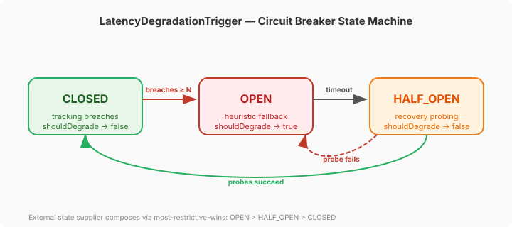

# Not Every Stumble Is a Fall

A latency spike is not a service failure. A slow LLM response is not an outage. But if your degradation system can't tell the difference, it treats every stumble as a fall — and every recovery as an invitation to stumble again.

That's what `LatencyDegradationTrigger` was doing. It tracked LLM call latency in a sliding window, counted breaches above a threshold, and returned a boolean: degrade or don't. When breaches piled up, the system routed to heuristic fallback. When the window entries expired by time, the boolean flipped back — and the next call went straight through the LLM at full rate.

The problem isn't the detection. The sliding window is fine. The problem is the recovery.

## The oscillation nobody tested

When a latency issue is intermittent — the common case with LLM providers under load — the trigger creates a feedback loop. Breaches accumulate, the trigger fires, heuristic fallback absorbs the load. Time passes, entries expire, the trigger clears. The system sends a full batch of LLM calls. The provider is still slow. Breaches accumulate again. Repeat.

Each cycle wastes budget on calls that were always going to be slow, and each transition between degraded and non-degraded state produces a discontinuity in the agent's reasoning quality. The agent oscillates between heuristic (fast but shallow) and LLM (slow and expensive) with no controlled transition between them.

This isn't hypothetical. Any topology that runs `LatencyDegradationTrigger` — Hierarchical, Distributed, Graduated, Hybrid, Hive, Centralised — is exposed to this pattern. All six topologies construct these triggers independently, each tracking its own sliding window. If the underlying LLM provider is having latency issues, six independent triggers independently discover this through their own failed calls, and six independent triggers independently flood the provider when their windows expire.

## Circuit breakers exist for this reason

The standard circuit breaker pattern — Fowler's description, Resilience4j's implementation, Hystrix before it — solves exactly this problem with three states instead of two:



**CLOSED** is normal operation. Track breaches. When the breach count exceeds the threshold, transition to OPEN.

**OPEN** is degraded. All calls route to the heuristic fallback. No LLM calls happen, so no new breach entries arrive. Wait for a recovery timeout.

**HALF_OPEN** is the controlled recovery probe. After the timeout, allow a limited number of calls through the LLM. If the probes succeed — latency is back under threshold — transition to CLOSED. If any probe fails, re-open and restart the timer.

HALF_OPEN is the state `LatencyDegradationTrigger` was missing. Without it, recovery is uncontrolled: the trigger goes from "block everything" to "allow everything" in a single call. With it, recovery is gradual: one call at a time, with the ability to back off if the provider is still struggling.

The fit is natural because the topology's `InFlightGate` already enforces at-most-one concurrent call per agent loop. HALF_OPEN doesn't need a separate concurrency limiter — the architecture already serialises probes.

## What the boolean hid

The original `shouldDegrade()` returned a boolean. `DegradationAwareSummariser` called it, got true or false, and routed accordingly. This interface is fine for the consumer — the summariser doesn't need to know about state machines. But the trigger itself needs richer internal state to make correct decisions.

The fix layers two interfaces. `DegradationTrigger` stays as it was — `boolean shouldDegrade()`, a `@FunctionalInterface`, backward compatible. `StatefulDegradationTrigger` extends it with `CircuitBreakerState state()`, using the existing `CircuitBreakerState` enum from engine-api (CLOSED, OPEN, HALF_OPEN). Only triggers with natural circuit breaker semantics implement the richer interface. `BudgetDegradationTrigger` and `CascadeDegradationTrigger` stay boolean — they don't have state machines and don't need one.

`CompositeDegradationTrigger` derives its state from children. For children that implement `StatefulDegradationTrigger`, it reads their state directly. For plain `DegradationTrigger` children, it infers OPEN or CLOSED from `shouldDegrade()`. The most restrictive child wins.

## The coordination primitive

The trigger now accepts an optional `Supplier<CircuitBreakerState>` — an external state input. When present, `shouldDegrade()` and `state()` consider both local and external state, most-restrictive-wins. If the local state is HALF_OPEN (recovery probing) but external state is OPEN (the platform knows something the trigger doesn't), the effective state is OPEN and probing is suppressed.

This is the building block for platform-wide coordination. Right now, each trigger tracks its own sliding window in isolation. With the external supplier, a shared registry keyed by LLM provider can aggregate state from all triggers. When any trigger opens, the registry reflects that to every trigger talking to the same provider — no need for each one to independently discover the problem.

The registry is follow-up work. This change provides the primitive it needs: a trigger that can read external state and compose it with its own. Without this input, coordination is impossible regardless of what sits upstream.

## Thread safety on the hot path

The trigger is called from two threads: `accept()` from the budget event sink (delivering LLM call metrics), and `shouldDegrade()` from the agent loop thread (on every summarise call). Both must be fast.

State transitions use `AtomicReference<CircuitBreakerState>` with compare-and-set. No locks. The recovery timeout check reads a volatile `Instant` field. The probe counter is an `AtomicInteger`. The worst case under contention is a CAS retry, which costs nanoseconds — invisible against the millisecond-scale LLM latency that drives the state machine.

## What changed

The dead `windowSize` constructor parameter — accepted but never stored — is gone. The constructor is now private behind a builder that takes `LlmInvocationPolicy` and `LatencyCircuitBreakerConfig`, with optional `externalState()` and `onTransition()` for state change listeners. All six topologies migrated from the old 4-parameter constructor to the builder.

`DegradationPolicy` dropped `latencyBreachWindow` (the count-based window that was never enforced) and gained `recoveryTimeout` (default 30 seconds) and `probeSuccessThreshold` (default 2 consecutive successes to close). A `toLatencyConfig()` convenience method extracts the circuit breaker config, so topology wiring is a single line:

```java
LatencyDegradationTrigger.builder(policy, dp.toLatencyConfig()).build()
```

The transition listener fires on every local state change — CLOSED→OPEN, OPEN→HALF_OPEN, HALF_OPEN→CLOSED, HALF_OPEN→OPEN. This is the observability hook: wire it to metrics, logging, or the future coordination registry.

538 tests pass. The new test suite covers all state transitions, the external supplier interaction (including the external-blocks-probing edge case), and the transition listener through a full cycle. The existing topology tests pass unchanged — the behavioral contract (`shouldDegrade()` semantics) is preserved even though the internal model is completely different.

The circuit breaker is a better model for degradation than a boolean. Not because it's more complex — it's three states instead of one boolean — but because it separates three concerns the boolean conflated: detecting the problem (breach counting), protecting during the problem (heuristic fallback), and testing whether the problem is over (recovery probing). A boolean can only say "yes" or "no". A state machine can say "not yet — let me check first."
