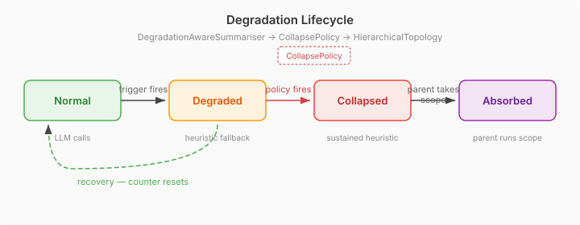
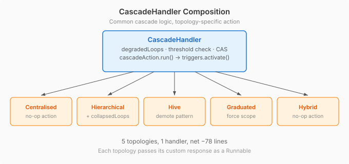

# When Degradation Becomes Collapse

The previous entry covered how a circuit breaker replaces the boolean degradation trigger with a proper state machine. That solved the oscillation problem — but it raised a harder question. When an agent loop degrades and stays degraded, what happens next?

The answer, until now, was nothing. The loop runs heuristic fallback indefinitely. The topology knows it's degraded — `DegradedEvent` fires, the cascade threshold tracks it — but there's no escalation. A loop that's been on heuristic for thirty seconds looks exactly the same to the topology as one that just entered fallback. Time doesn't change the response.

That's wrong. Sustained degradation is a different signal from momentary degradation. A loop that's been on heuristic for one call is recovering — give it a moment. A loop that's been on heuristic for twenty calls isn't recovering; it's collapsed, and the parent should absorb its scope before the work stalls.

## The missing lifecycle stage

The degradation system had two states: normal and degraded. What it needed was three: normal, degraded, and collapsed.



**Normal** — the LLM handles reasoning. Full capability.

**Degraded** — the trigger fired, heuristic fallback is active. The loop is still running, still producing decisions, but at reduced quality. Recovery is expected.

**Collapsed** — degradation has persisted beyond a threshold. Recovery isn't happening. The topology should respond structurally: in a hierarchical topology, the parent absorbs the child's scope and runs it directly.

The `collapsed` flag already existed on `DegradedEvent` — added during the scope absorption work — but nothing ever set it to true. `DegradationAwareSummariser` always constructed the event with the three-argument constructor, which defaults `collapsed` to false. The flag was wired through the entire event chain, from `DegradedEvent` through `DecisionLoopEvent.Degraded` to the telemetry pipeline, but it was always false.

## CollapsePolicy

The question isn't whether to collapse — it's when. That's a policy decision, not a mechanism decision, so it belongs behind an interface.

```java
@FunctionalInterface
public interface CollapsePolicy {
    boolean isCollapsed(int consecutiveDegradedCalls, long degradedDurationMs);

    static CollapsePolicy never() { ... }
    static CollapsePolicy afterCalls(int threshold) { ... }
    static CollapsePolicy afterDuration(Duration threshold) { ... }
}
```

The summariser tracks the count and timestamp. On each degraded call, it checks the policy. If the policy says collapse, it emits a `DegradedEvent` with `collapsed=true` — a one-time transition, guarded by `AtomicBoolean` CAS, same pattern as the initial degradation event. Recovery resets everything: the counter, the timestamp, the collapsed flag.

The two inputs — call count and elapsed duration — cover the most useful policies without overcomplicating the interface. Count-based (`afterCalls(10)`) is deterministic and easy to test. Duration-based (`afterDuration(Duration.ofSeconds(30))`) handles the case where calls are infrequent but the degradation is persistent. Both can be composed by implementing the interface directly.

## Cascade duplication

Five topologies — Centralised, Hierarchical, Hybrid, Hive, Graduated — all contained the same cascade-tracking boilerplate: a `ConcurrentHashMap.newKeySet()` for degraded loops, an `AtomicBoolean` for the one-way cascade ratchet, a threshold check, and trigger activation. Roughly 15 lines each, identical in structure, different only in what happens after the cascade fires.

Centralised and Hybrid do nothing special — they just activate the cascade triggers. Hive demotes its orchestration pattern: DEBATE drops to VOTING, VOTING drops to SUPERVISOR. Graduated forces all agents to `STIMULUS_DRIVEN` scope. Hierarchical adds its own `collapsedLoops` tracking on top of the common pattern.

`CascadeHandler` extracts the common core. Each topology passes its custom response as a `Runnable`:



The `Runnable` runs before the triggers activate — same ordering as the original inline code. Topologies with no custom action use the convenience constructor that defaults to a no-op. The handler initialises with safe defaults so `onDegradation()` works before `configure()` is called, which matters for topologies whose tests exercise degradation without a full topology context.

## Telemetry wiring

`DecisionLoopEvent.ReasoningCompleted` carries `tokensConsumed` and `latencyMs` from actual LLM calls, but this data never reached the engine's `SwarmTelemetry` record. The gap was straightforward: `SwarmCoordinatorBuilder` created the topology without a `loopEventSink`, so the event consumer was always a no-op.

The fix adds `loopEventSink()` to the builder, which sets it on `CentralisedTopology`. At configure time, the topology prefers its own sink over whatever the `TopologyContext` provides. This lets the caller wire an `LlmTelemetryAccumulator` — which already existed, implementing both `Consumer<DecisionLoopEvent>` and the engine's `AgentLlmStatsProvider` SPI — to bridge decision loop metrics into the engine's telemetry pipeline.

The engine side still needs to create the SPI in engine-api and consume it in `SwarmTelemetryCollector`. That's the companion work. The agency side is wired and ready.

## What this closes

The coordination infrastructure epic started with parentMap validation and token recording — the mechanical cleanups left over from the original swarm coordination build. It ended with the collapse lifecycle, a reusable cascade primitive, and the telemetry bridge. Fourteen issues across three themes: topology lifecycle, degradation handling, and observability.

The degradation system now has a full signal path: trigger fires → heuristic fallback → collapse policy evaluates → collapsed event emits → topology absorbs scope → telemetry records it all. Each stage is a separate concern with its own interface. The topology doesn't know about collapse policies. The collapse policy doesn't know about cascades. The cascade handler doesn't know about scope absorption. They compose through events and callbacks.

The practical value is that consumers can now distinguish between a temporary LLM hiccup and a persistent failure. A `CollapsePolicy.afterCalls(10)` on a hierarchical topology means the parent takes over after ten consecutive heuristic calls — not after one spike, not after a provider restart, but after sustained evidence that the child can't recover. That's the distinction the boolean couldn't express.

