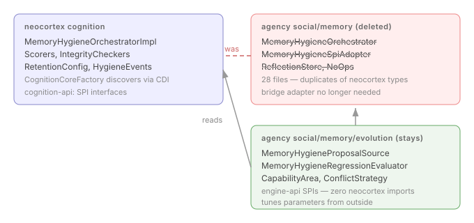

# The Bridge That Outlived Its Reason

When you extract a subsystem from one module to another, the extraction itself is the easy part. The hard part is finding everything that grew up around the old boundary — the adapters, the no-ops, the bridge classes that were necessary when the boundary was in one place and become dead weight when it moves.

Agency's memory hygiene code was a textbook case. The `MemoryHygieneOrchestrator` lived in `agency-core` but implemented an SPI defined in neocortex's `cognition-api`. To make this work, a `MemoryHygieneSpiAdapter` sat between the two — taking agency's implementation and presenting it as neocortex's interface. `AgencyBeans` wired it all up with a conditional producer: if the orchestrator was resolvable, wrap it in the adapter; otherwise return null.

This was correct architecture at the time. The implementation had dependencies on agency types (ContentSummariser, KeyedLock) while the consumer lived in neocortex's CognitionCore. The adapter bridged the gap.

Then neocortex absorbed the implementation. The types moved, the tests moved, the package changed from `io.casehub.agency.social.memory` to `io.casehub.neocortex.cognition.memory`. CognitionCoreFactory now discovers `MemoryHygieneOrchestratorImpl` directly through CDI. The bridge was no longer bridging anything — both ends were in the same module.

## What the cleanup actually involved

The deletion list was 28 files — 23 source files and 5 test files. That sounds dramatic until you realise they were all dead code: exact duplicates of types that now live in neocortex. The real work was in the files that *stayed*.

`AgencyBeans` needed four producers removed and one retype. The `ReflectionQueryStore` case was instructive — agency had its own `ReflectionQueryStore` interface that extended neocortex's, but the two were now identical (same methods, same defaults). The agency version was a pure redundant wrapper. Replacing it with the neocortex type in the `narrativePipeline()` signature was the entire change.

The evolution loop types — seven files implementing engine-api SPIs like `ImprovementProposalSource` and `RegressionEvaluator` — stayed in agency. They have zero neocortex imports. They implement engine SPIs, not cognitive SPIs. The boundary is clean: neocortex owns the cognitive pipeline and its parameters; agency owns the evolution loop that tunes those parameters from outside.

## The diagnostic that matters

The telling metric wasn't file count — it was import count. Seventeen of the 33 original files imported from `io.casehub.neocortex`. They were agency residents commuting to neocortex every day. When more than half your types depend on a module you don't own, you're not an independent subsystem — you're an annex that hasn't moved yet.

The evolution types tell the opposite story: zero neocortex imports across all seven files. They implement engine-api SPIs and consume their own local records. The dependency arrow points the right way. That's why they stay.

## The gotcha

The one surprise was `agentic-yaml`. Its `ConfidenceScorerRegistry` and `CognitionCompiler` imported scorer types from the old agency package. The imports needed updating to point at neocortex — straightforward — but the module also needed a new `provided` dependency on `casehub-neocortex-cognition` since the implementations (not just the SPIs) live in that jar now.

Pre-existing build failures in `agency-spring` and `agentic-yaml` from an unrelated rename in neocortex (`PersonalityEvolutionConfig` removed) masked our changes during the first build attempt. Isolating the core modules confirmed the migration was clean before the noise cleared.
