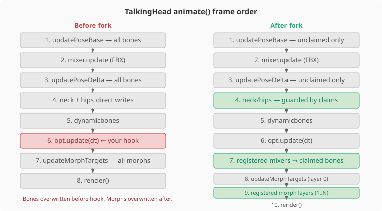

TalkingHead is a good library. It loads ReadyPlayerMe avatars, drives visemes from audio, handles moods and eye contact, plays Mixamo animations, and manages a camera — all in one ES module. For a demo where TalkingHead owns the avatar, it's excellent. The problem starts when you want to share ownership.

We have 68 body animation clips — conversational stances, gestures, idle cycles, dances — that need to play on the same skeleton TalkingHead controls. The obvious approach: use `opt.update(dt)`, the per-frame callback TalkingHead provides. Write your body bones in the callback, let TalkingHead handle the head.

## The frame order that breaks everything

Claude pulled the TalkingHead source and mapped the exact frame order inside `animate()`:

```
1. updatePoseBase()       — writes ALL bones from pose templates
2. mixer.update()         — FBX animation (Mixamo)
3. updatePoseDelta()      — additive deltas on ALL bones
4. [neck volume rotation] — direct quaternion write
5. [hips balance]         — direct position write
6. dynamicbones.update()
7. opt.update(dt)         ← YOUR HOOK IS HERE
8. updateMorphTargets()   — writes ALL morph targets
9. render()
```

The hook runs at step 7. Steps 1–5 have already overwritten every bone on the skeleton. Any bone values you wrote last frame are gone — `updatePoseBase` unconditionally writes them from its pose templates. You can write them again in `opt.update`, and they'll survive until the next frame, where `updatePoseBase` overwrites them again. It works, technically. You're fighting the library every frame.

The morph situation is worse. `updateMorphTargets` runs *after* the hook, at step 8. Any morph target values you set in `opt.update` get clobbered before render. There's no post-morph callback. If you want to add expression curves from body animations — a frown during a shrug, a brow raise during confusion — you have no hook point that survives to the screen.

`modelMovementFactor` exists, but it's a scalar multiplier on upper-body movement. It doesn't skip bones; it pulls them toward a straight pose. The bones are still written.

## What "clean extension points" means here

The question was: fork TalkingHead and add quick filter hacks, or design proper abstractions? I wanted the latter — something the upstream maintainer might actually accept.

Four additions, all non-breaking:

**Bone ownership.** A canonical bone vocabulary — `Hips`, `Spine`, `LeftUpperArm`, etc. — with rig mappings underneath so callers don't need to know whether the avatar uses Mixamo naming (`mixamorig:Spine`) or RPM naming (`Spine`). External systems claim bones by canonical name. TalkingHead's pose system skips claimed bones in `updatePoseBase` and `updatePoseDelta`, and guards the direct neck and hips writes.

**Morph layer registry.** TalkingHead's internal face writes (blink, mood, eyes) become layer 0. External systems register additional layers with an ordering and a blend mode — `replace` for visemes, `additive` for expression curves. The pipeline runs all layers after `updateMorphTargets`. Each layer gets `getInfluence`/`setInfluence` accessors that work by morph target name, not array index.

**External mixer registration.** `registerMixer(mixer, { boneClaim })` — TalkingHead calls `mixer.update(dt)` in its own frame loop at the right position. This eliminates the separate `requestAnimationFrame` loop the demo was running for body animations. Two independent rAF loops on the same skeleton create ordering indeterminacy; a registered mixer makes it one coordinated frame step.

**Lifecycle events.** `addEventListener('statechange', ...)` — standard EventTarget. TalkingHead already tracks idle/speaking internally but doesn't expose transitions. The events cover `statechange`, `moodchange`, `audiostart`, and `audioend`.

## Why this matters beyond our use case

TalkingHead is used by hobbyists, indie devs, and research projects. The body animation question comes up for anyone loading a full-body avatar — and TalkingHead explicitly supports full-body GLB models with Mixamo FBX animations. But its internal architecture assumes it's the only writer. Any external system that wants to share the skeleton or the face hits the same frame-order wall.

The bone ownership model, with its canonical vocabulary, solves a problem every TalkingHead user faces when they try to compose with external animation. The morph layer registry does the same for anyone building a custom viseme pipeline or expression system. These aren't CaseHub-specific workarounds — they're genuine gaps in the library's composability model.

## The practical outcome

The fork is temporary. The changes sit in `casehubio/TalkingHead` on GitHub, and the built module is vendored into our speech-demo as a local import. No CI changes, no npm publishing. If the upstream maintainer accepts the PRs, we revert the import map URL to the CDN and delete the vendor file. If not, we maintain a thin overlay — 207 lines of additions against a 4,900-line module.

Meanwhile, the avatar pipeline design simplifies significantly. The original spec had a verification spike, a `scene.onBeforeRender` workaround, and careful render-hook ordering analysis. All of that is gone. Body animations register their mixer, visemes and expression curves register as morph layers, and `speakAudio` with its `markers` array handles gesture timing. The architectural workarounds became clean API calls.



The body animation integration (#457) can now proceed without workarounds. The server-side foundation — vocabulary SPI, protocol types, utterance segmenter — is already landed. Next is the session refactor that wires it all together.
