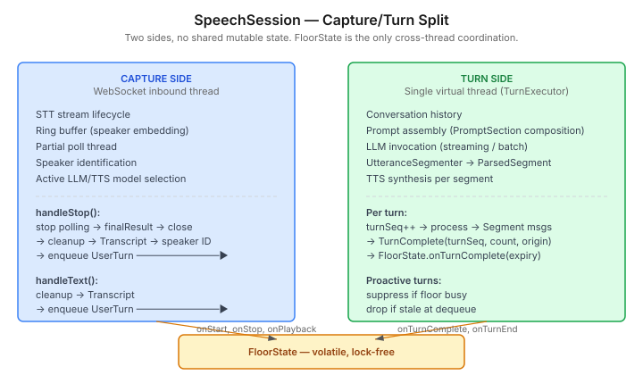

Continues from [The frame loop you can't hook into](2026-11-18-mdp01-the-frame-loop-you-cant-hook-into.md).

# The session that couldn't listen and talk

The avatar speech pipeline had a monolith at its centre. `SpeechSession` — 535 lines — owned everything: the STT stream, the ring buffer for speaker identification, partial result polling, conversation history, prompt assembly, LLM invocation, TTS synthesis, and every outbound WebSocket message. All of it ran on the WebSocket inbound thread. For a simple request-response demo, this worked fine.

The problem surfaced when we tried to add proactive speech. A cognitive agent periodically evaluates whether the avatar should say something unprompted — a greeting after silence, a follow-up observation, a topic the agent finds interesting. The evaluation happens on a background thread. When it produces content, that content needs to become speech: prompt assembly, TTS, outbound messages. The same pipeline the user's voice is going through.

Two threads. One `SpeechSession`. Shared mutable history, shared TTS state, interleaved outbound messages. The original code just called `handleProactiveSpeech()` from the background thread and hoped for the best.

## The split that the design demanded

The fix is older than threads. Separate the concerns by ownership. The design (D10 from the spec, three rounds of adversarial review) defines two sides:

**Capture side** — the WebSocket inbound thread. Owns the STT stream, the ring buffer, speaker identification, partial polling. Everything that's about *hearing the user*. When the user stops speaking, the capture side finalises the stream, runs speaker ID, sends the transcript, and hands off an immutable `UserTurn` record.

**Turn side** — a single virtual thread running a `TurnExecutor`. Owns history, prompt assembly, LLM invocation, TTS, and all turn-framed outbound messages. One turn at a time, serialised. User turns and proactive turns go through the same executor.

They share no mutable state. The capture side writes `UserTurn(cleanText, speakerLabel, llmModel, ttsModel)`. The turn side reads it. That's the entire interface.



## Why "no shared mutable state" matters here

The original `handleStop()` did everything in sequence: stop polling, finalise the stream, clean up text, identify the speaker, generate a response, synthesise audio, send messages. That sequence is correct on a single thread. But a proactive turn can fire between any two of those steps. If a proactive turn writes to history while `handleStop()` is building a prompt from that same history, you get a prompt that includes half the proactive response in the conversation context. The LLM sees a conversation that never happened.

The serialising executor eliminates this. User turns block through the executor (`Future.get()`), so from the capture side's perspective, `handleStop()` still returns after the turn completes. But if a proactive turn is in flight, the user turn queues behind it. One turn finishes before the next begins. History is never read and written concurrently.

The design also gives proactive turns a staleness check. A proactive evaluation might take seconds — the cognitive agent runs an LLM internally. By the time the content is ready, the user may have started talking. The executor checks: did user activity happen after this proactive turn was evaluated? If yes, drop it. The user's context has changed; stale content would be non sequitur.

## FloorState — the one thing both sides touch

One object straddles the boundary: `FloorState`. It tracks whether the avatar should suppress proactive speech. Three conditions gate proactive evaluation:

- **Listening** — the user started the microphone but hasn't stopped
- **Turn in flight** — a turn is being processed
- **Unacknowledged playback** — the server sent a turn but the client hasn't confirmed it played

All fields are `volatile`. No compound atomic operations — each field is independently written by one side at a time. The capture side writes `onStart()` and `onStopOrText()`. The turn side writes `onTurnComplete()` and `onTurnEnd()`. The proactive tick thread reads `shouldSuppressProactive()`. Volatile visibility is sufficient because the only cross-thread question is "should I suppress?" — a stale answer is harmless (it means suppressing one tick too many, not one too few).

One subtlety we caught in review: the `finally` block in turn processing originally called `onTurnEnd()` before `onTurnComplete()`. Between those two volatile writes, `shouldSuppressProactive()` returns false — no turn in flight, no unacknowledged turn. If the proactive tick reads exactly in that nanosecond window, it sees a clear floor and fires. The fix: write `onTurnComplete()` first, then `onTurnEnd()`. The unacknowledged turn is registered before the in-flight flag clears. The suppression chain has no gap.

## Turn-framed protocol

The old protocol sent `Response` (full text) and `Phonemes` (viseme timeline) per sentence, with no concept of turns. The new protocol adds `Segment` and `TurnComplete`:

```java
record Segment(int turnSeq, int index, String text,
               boolean hasAudio, List<VisemeFrame> visemes,
               List<Cue> cues) {}

record TurnComplete(int turnSeq, int segmentCount,
                    TurnOrigin origin) {}
```

Every turn gets a `turnSeq`. Every sentence becomes a `Segment` with its index within the turn. `TurnComplete` closes the turn. The client can now pair audio frames to segments by identity instead of arrival order, and it knows exactly when a turn ends — which is what drives the floor state machine on the client side.

`TurnComplete` is emitted in a `finally` block. If the LLM throws, the turn still closes. If TTS fails for one sentence, that sentence's `Segment` is sent with `hasAudio: false` and an `Error` message names which segment failed. The client shows the text and skips the audio. No sentence is ever lost.

During the transition, `TurnExecutor` emits both old and new protocol messages. The existing demo client sees `Response` and `Phonemes` and works as before. When the client is updated to handle `Segment` and `TurnComplete`, the legacy messages get removed.

## The prompt that knows about gestures

The other half of this session's work was simpler but architecturally important. `DefaultPromptAssembler` now accepts a `List<PromptSection>` — composable contributors to the system prompt. Each section receives a `PromptContext` (agent ID, tenant ID, subject ID) and returns a nullable string.

`GesturePromptSection` is the first real implementation. It reads the performance vocabulary — the same JSON file that holds the 68 animation clips, the taxonomy, and the pools — filters for `promptable` entries, and renders them into the system prompt:

```
You may annotate your response with tags.

Gestures (place before the associated word):
[gesture:nod] — agreement, understanding
[gesture:shrug] — uncertainty, "I don't know"
...

Rules: at most one gesture per sentence. Only use when it fits naturally.
```

The LLM sees the available gestures and their semantics. When it generates `[gesture:nod] That's a good point`, the `UtteranceSegmenter` (from the previous session) parses the tag, validates it against the vocabulary, and produces a `ParsedSegment` with a `GestureCue` at word position 0. That cue flows through the `Segment` message to the client, which triggers the body animation at the right moment in the audio timeline.

The vocabulary is the single source of truth. Add a gesture to the JSON, and it's available in the LLM prompt, validated by the segmenter, and playable by the animation system. No code changes.

## What this opens up

The session refactor is structural — it doesn't add visible features by itself. But it unblocks everything that follows. Client-side floor states (idle, listening, thinking, speaking) now have the protocol signals they need. Gesture timing needs mark positions from the TTS engine, which needs a connectors peer issue to land. Mood ownership (cognition vs LLM) needs the turn framing to know when to hold and when to decay. Idle attention bids need the floor state to know when silence is real silence vs processing latency.

The avatar's body language system has the vocabulary, the protocol, the segmenter, and now the session architecture. What remains is the client wiring and the TTS timing integration — both of which are downstream of infrastructure that's now in place.
