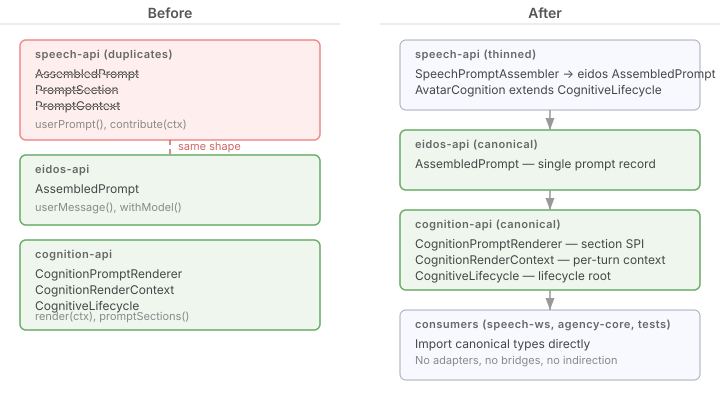

# Three Prompts, One Answer

Three modules had independently grown their own prompt assembly abstractions. speech-api had `AssembledPrompt`, `PromptSection`, and `PromptContext`. eidos-api had its own `AssembledPrompt`. cognition-api had `CognitionPromptRenderer` and `CognitionRenderContext`. All three described the same thing: how to build an LLM prompt, what context to pass, and what sections to contribute.

The tempting move is to build a fourth abstraction that unifies the other three. The right move is to pick the best one and delete the others.

## Why speech-api had its own types

When social cognition was first wired into the avatar speech pipeline, speech-api was the natural place for the prompt types. `SpeechPromptAssembler` needed a return type — `AssembledPrompt` appeared. Cognitive sections needed a contribution SPI — `PromptSection` appeared. Those sections needed per-turn context — `PromptContext` appeared.

Each type was small, correct, and locally justified. The problem wasn't the design — it was timing. These types were created before eidos-api gained `AssembledPrompt` (with its `model` field and `withModel()` builder) and before cognition-api gained `CognitiveLifecycle` with its `CognitionPromptRenderer` and `CognitionRenderContext`. Once those canonical homes existed, the speech-api types became duplicates — same shape, different package.

## What deletion looks like

The diff is 16 files, net -31 lines. Three files deleted outright. The remaining changes are import swaps and one accessor rename: speech-api called the user message field `userPrompt()`, eidos-api calls it `userMessage()`.

`AvatarCognition` shrank from a five-method interface to a one-method extension of `CognitiveLifecycle`. The four lifecycle methods — `initialize`, `tick`, `evaluateProactive`, `recordInteraction` — were already identical to `CognitiveLifecycle`'s signatures. `AvatarCognition` becomes `extends CognitiveLifecycle` plus the speech-specific `wrapAssembler()`. That's the only method speech needs that cognition doesn't provide.

`CognitionAvatarAdapter` gained one new method (`promptSections()` delegating to `CognitionCore`) and lost the `PromptContext` indirection. The old code created a `PromptContext`, then immediately extracted its fields to build a `CognitionRenderContext`. We cut out the middleman — build the `CognitionRenderContext` directly from the closure-captured `agentId`, `tenantId`, and `subjectIdSupplier`.

## The accessor rename that ripples

The one genuinely tedious part: `userPrompt()` → `userMessage()`. speech-api's `AssembledPrompt` called the second field `userPrompt`. eidos-api calls it `userMessage`. Every call site in speech-ws — `SpeechSession`, `SpeechWebSocket`, `DefaultPromptAssembler`, plus all their tests — needed the rename. Nine replacements in `DefaultPromptAssemblerTest` alone.

This is the kind of change that feels mechanical but catches you if you rush it. The same string `userPrompt` appears as a local variable name throughout agency-core (in `LlmContentSummariser`, `LlmTriageHandler`, `RoutingSupport`, etc.) — but those reference `AgentSessionConfig.userPrompt()`, not `AssembledPrompt.userPrompt()`. Different type, same name. A blind find-and-replace would have broken working code. IntelliJ's type-aware search kept the blast radius correct.

## The test code that was already broken

The agentic-yaml test code — `ConversationRunner`, `DirectivePromptSection`, `CognitionDiagnostic` — was already importing speech-api's `PromptSection` while `CognitionStack.promptSections()` returned `List<CognitionPromptRenderer>`. The neocortex migration in the previous session had moved the return type but not the consumers. This change fixed the type mismatch: `DirectivePromptSection` now implements `CognitionPromptRenderer`, and the test harness uses `CognitionRenderContext` directly.

## The principle

When parallel abstractions converge on the same shape, the answer is not a unifying wrapper — it's picking the canonical home and deleting the rest. The canonical home is whichever module owns the concept: eidos owns agent identity and prompt construction, cognition-api owns the cognitive lifecycle and rendering. speech-api owns only what's genuinely speech-specific: conversation turn formatting and the assembler-wrapping decorator.

The dependency graph tells you when you've got it right. speech-api now depends on eidos-api and cognition-api — it imports their types. It no longer defines competing types that happen to have the same fields. The boundary moved from "speech-api provides prompt types" to "speech-api composes prompt types that live elsewhere." That's the right shape for a module that sits between audio I/O and cognitive enrichment.
