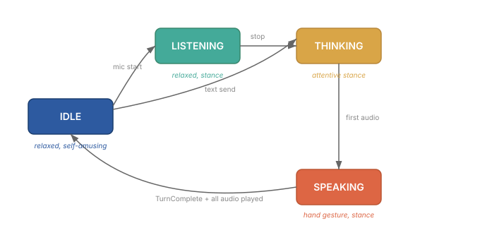
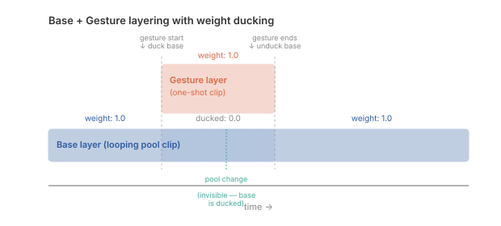

Continues from [The session that couldn't listen and talk](2026-11-18-mdp02-the-session-that-couldnt-listen-and-talk.md).

# The floor the avatar never had

The server knew when the user was speaking, when the LLM was thinking, and when TTS was generating audio. The client knew none of this. It had a boolean — `speaking` or not speaking — toggled by queue drain events that fired between sentences whenever synthesis was slow. The avatar would flicker between idle dances and hand gestures every time Kokoro took an extra 200ms on a sentence.

The underlying problem: the client had no concept of a conversational floor. In linguistics, floor control is who holds the conversation — who's speaking, who's listening, who's waiting for their turn. Human conversationalists manage this instinctively through eye contact, posture shifts, and micro-gestures. An avatar that doesn't know whose turn it is can't do any of that.

## Four states, one state machine

The floor state machine gives the avatar the concept it was missing:

Each state selects a different animation pool from `avatar-performance.json`. The pools are what make the states visible:

**Idle** draws from relaxed poses, self-amusing clips (guitar, drumming, moonwalk), and occasional dances. This is the avatar at rest — nobody is talking, nothing is happening. The variety keeps it alive without suggesting it's paying attention to anything specific.

**Listening** narrows to relaxed stances and conversational posture. No fidgeting, no dances. The avatar is engaged but quiet — the kind of body language you show when someone is mid-sentence.

**Thinking** narrows further to attentive stances only: subtle idle, hands clasped, listening pose. The 1–3 seconds between the user finishing and the first audio arriving is where this matters most. Without it, the avatar just stood there in whatever idle pose it happened to be in. With it, the posture shifts to something that reads as "processing" — a natural stance change, not a loading spinner.

**Speaking** broadens to hand gestures, stances, agreement, uncertainty, and emphasis clips. The avatar is animated because it's the one talking. This is where the gesture tags from the LLM land — `[gesture:nod]` or `[gesture:shrug]` interrupt the base rotation with a specific one-shot clip.

## The protocol bridge

The state machine is straightforward. The harder problem was getting the right signals to it. The server's new turn-framed protocol — `Segment` and `TurnComplete` — carries the information the client needs, but the client has to interpret it correctly.

A turn's lifecycle from the client's perspective:

1. User sends text (or stops recording) → enter **thinking**
2. First `Segment` arrives with `hasAudio: true` → buffer it, wait for audio
3. Binary audio frame arrives with an 8-byte header identifying `(turnSeq, segmentIndex)` → pair with segment, start playing → enter **speaking**
4. More segments and audio frames arrive → play in sequence
5. `TurnComplete(turnSeq, segmentCount)` arrives → mark turn as complete
6. Last audio frame finishes playing → verify all `hasAudio` segments have played → enter **idle**, send `PlaybackComplete(turnSeq)` back to server

The critical insight from the design review: speaking state follows the *turn*, not the audio queue. The old code entered idle every time `playQueue` drained between sentences. The new code stays in speaking until both conditions are met: the server has said the turn is complete, and all audio has played. Mid-turn queue drains — caused by slow TTS on sentence N+1 — don't change state.

A 10-second safety timer catches the edge case where `TurnComplete` never arrives (dropped connection). Without it, a lost message would leave the avatar stuck in speaking forever.

## Base and gesture — two layers, not one

The old `BodyAnimationSystem` had a single action slot. Every `play()` call crossfaded from whatever was playing. This meant `setSpeaking(true)` pre-empted any in-flight gesture, and a gesture at word-0 raced the speaking pool switch. The avatar would start a shrug, get cut off by the pool change, then settle into a hand-gesture clip — the shrug wasted.

The fix is two layers with weight ducking:

The base layer loops the current pool clip. The gesture layer plays one-shot clips triggered by gesture tags. When a gesture starts, the base weight ducks to zero over 300ms and the gesture weight rises to full. When the gesture finishes, the reverse happens. The base clip keeps playing underneath — it's just inaudible. Pool changes during a gesture swap the base clip with no visible effect because the base weight is zero.

The implementation uses three.js's `setEffectiveWeight()` on both actions, animated per-frame in the `update(dt)` callback. The cycle timer — which periodically switches the base clip for variety — runs independently and never touches the gesture layer. This fixed a bug in the old code where the cycle timer didn't restart after a gesture finished, leaving the avatar stuck on whatever clip the gesture had been playing over.

## Data-driven, not hardcoded

The old `body-animations.mjs` had 300 lines of hardcoded taxonomy data: `TAXONOMY`, `SPEAKING_POOL_REFS`, `IDLE_POOL_REFS`, `GESTURE_MAP`, `KEYWORD_GESTURES`. The same data existed in `avatar-performance.json` for the server's vocabulary validation. Two copies, inevitably out of sync — the build copy already referenced deleted clips (`thinker`, `shocked-recoil`).

The rewrite loads everything from the JSON at construction time. `BodyAnimationSystem.create(avatarRoot, config)` takes the parsed JSON as a config object. The taxonomy, pools, and gesture map are all data, not code. Adding a new gesture or adjusting pool weights is a JSON edit, not a code change. The module went from 407 lines to 169.

The keyword fallback system (`KEYWORD_GESTURES`, `KEYWORD_MOODS`) was deleted entirely. With the LLM now receiving gesture instructions through the prompt (via `GesturePromptSection`), the substring-matching fallback was doing more harm than good — `"hi "` matching `"sushi "`, `"yes"` matching `"eyes"`. The base speaking pool provides continuous conversational motion when the LLM chooses no gesture, which is now a valid choice under the density rules.

## The cascade

What started as "wire floor states into body-animations.mjs" cascaded through six related issues in the same session. The UtteranceSegmenter had position-tracking bugs with duplicate sentences — `indexOf` finding the wrong occurrence when two sentences matched. The TurnExecutor was swallowing `InterruptedException`. The binary audio frames needed 8-byte headers so the client could pair them with segments. The legacy `Response` and `Phonemes` messages could finally be removed since the client no longer depended on them. The streaming TTS path hadn't been ported to the new protocol. And the silence attention policy — idle gestures after 30 seconds of silence — could be wired up now that the floor state machine existed.

Each fix was small. Together they closed the gap between the server's turn-framed protocol and the client's visual behaviour. The avatar now transitions from idle to listening when the mic opens, to thinking when it closes, to speaking when audio arrives, and back to idle when the turn is done. The body language matches what's happening in the conversation.

The next piece is face compositing — morph target layering for expression curves from body animations (the shrug frown, mostly). That depends on the TalkingHead fork's morph layer registry, which is in place but not yet wired from the body animation side. And mark timing — synchronising gesture strokes with specific words — is waiting on a connectors SPI change that just landed.
