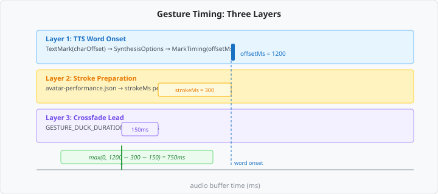

Continues from [The floor the avatar never had](2026-11-18-mdp03-the-floor-the-avatar-never-had.md).

# The protocol that couldn't feel

The turn-framed protocol shipped clean. Segments, turn sequences, cues, playback acknowledgement — structurally complete, all tests green. The avatar sat there, received every message correctly, tracked floor state transitions, and spoke with a perfectly still face. No lip sync, no expressions, no gesture timing. The protocol was right; the experience was wrong.

This is the gap between *protocol correctness* and *experiential completeness*. A protocol migration replaces one wire format with another. The ecosystem that depended on the old format — viseme rendering, gesture scheduling, mood management, streaming audio handling — doesn't migrate automatically. It breaks silently, because the new protocol carries the same data in a different shape, and every consumer needs to adapt.

## Dead types, live problems

The first step was housekeeping. `Response`, `Phonemes`, `Animation`, and `Timing` — four message types that `TurnExecutor` no longer sent — were still in the sealed `AvatarMessage` hierarchy, their `MessageCodec` encode cases producing JSON nobody consumed, their tests exercising paths nobody walked. Removing them was mechanical (#505), but it exposed the real problem: what replaced them?

`Segment` messages carried viseme data in their `visemes` array and cues in their `cues` array. The client stored both dutifully in `pendingSegments` — and never rendered either.

## The lips that wouldn't move

The old pipeline had a custom `requestAnimationFrame` loop that iterated over viseme frames and set morph target weights directly. The turn-framed protocol removed that loop. `Segment` messages arrived with timing data intact, but the client's audio playback was a hand-rolled `AudioContext` queue that knew nothing about lip sync.

TalkingHead's `speakAudio()` was the designed replacement (D14). It accepts an `AudioBuffer` alongside flat arrays — `visemes[]`, `vtimes[]`, `vdurations[]` — and handles both audio playback and viseme rendering internally. The conversion from the server's `VisemeFrame` format is direct:

```javascript
r.visemes = []; r.vtimes = []; r.vdurations = [];
for (const v of seg.visemes) {
  r.visemes.push(v.viseme);
  r.vtimes.push(v.startMs);
  r.vdurations.push(v.endMs - v.startMs);
}
```

Gesture and mood cues become timed marker callbacks, so they fire at the right offset during playback instead of immediately on segment receipt. The old custom audio queue stays as a fallback for when the 3D avatar isn't loaded — text chat with audio still works without Three.js.

## The streaming race

With `speakAudio` wired, a subtler bug emerged. Streaming TTS engines send multiple WAV chunks per segment, all tagged with the same `segmentIndex` in the binary frame header. The client marks a segment as played on each chunk's completion. When the first chunk finishes while later chunks are still queued, `checkTurnFinished()` fires prematurely — the client sends `PlaybackComplete` to the server while audio is still playing.

The fix uses the reserved byte in the 8-byte binary header as an `isFinal` flag. The server-side pattern is a one-behind buffer:

```java
byte[][] lastChunk = {null};
streamingTts.synthesiseStreaming(text, options, chunk -> {
    if (lastChunk[0] != null) {
        sendAudioFrame(lastChunk[0], turnSeq, index, false);
    }
    lastChunk[0] = chunk;
});
if (lastChunk[0] != null) {
    sendAudioFrame(lastChunk[0], turnSeq, index, true);
}
```

Every chunk except the last goes out with `isFinal=0`. The buffered last chunk goes with `isFinal=1` after streaming completes. The client only marks the segment as played when it receives the final chunk. Single-frame non-streaming TTS always sends `isFinal=1` — the degenerate case where the buffer holds exactly one item.

## Three timing layers



Gesture synchronisation turned out to have three distinct timing layers, each owned by a different system:

**Layer 1: TTS word onsets.** The server places `TextMark` entries in `SynthesisOptions` at the character positions of gesture anchor words. The TTS engine returns `MarkTiming` with millisecond offsets for each mark — the moment the word begins in the audio buffer. For streaming TTS (which can't return marks), `offsetMs` stays at zero — gestures fire at segment start. For VITS/Piper with the guarded-exact implementation (connectors#303), marks are phoneme-counted against the duration predictor output with a consistency guard that falls back through phoneme-proportional and character-proportional tiers.

**Layer 2: Stroke preparation.** Each animation clip has a `strokeMs` value in `avatar-performance.json` — the time from clip start to the apex of the gesture. A head nod needs 150ms of preparation; a shrug needs 300ms. The client subtracts this from the word onset to start the gesture early enough that the stroke lands on the word.

**Layer 3: Crossfade overlap.** The body animation system fades between base pose and gesture over `GESTURE_DUCK_DURATION` (300ms). Half that crossfade time is additional lead. The final trigger formula:

```
triggerMs = max(0, offsetMs - strokeMs - 150)
```

The `max(0, ...)` clamp handles the case where the word onset is too early for the gesture's preparation time — the gesture fires immediately at segment start rather than trying to predict a negative offset.

## Mood ownership

Mood is the first feature where ownership splits cleanly between two runtime paths. When cognition is configured, mood is continuous — the `MoodOrchestrator`'s PAD model (pleasure, arousal, dominance) maps to Mehrabian octants with dead-zone, hysteresis, and dwell time. The proactive tick cycle polls the mapped mood and sends a `Mood(state)` message to the client on state change.

When cognition is absent, the LLM owns mood per-turn. `MoodCue` entries in segment cues set a turn-scoped override that decays after 3 seconds. The client manages priority: turn-scoped override trumps the cognition baseline, which trumps neutral.

The `MoodMapper` is intentionally conservative. A dead-zone of 0.25 (Euclidean magnitude in PAD space) means mild affect stays neutral. Hysteresis adds 0.1 to the transition threshold once a mood is adopted. A 5-second dwell time prevents rapid oscillation — the avatar won't bounce between hostile and anxious on alternating ticks.

## Face compositing

The last piece: body animation clips that carry morph target data (the shrug with a frown) need to compose with TalkingHead's viseme system. GLB clips embed morph target tracks alongside bone tracks. The existing clip loader stripped head bone tracks but left morph tracks alone — they passed through the filter but were never rendered, because TalkingHead's morph system doesn't know about the body animation mixer.

At load time, morph target tracks are now extracted from clips before the bone filter runs, converted from track indices to named expressions via the GLB mesh's `morphTargetDictionary`, and filtered through an allow-list of expression channels (brow, mouthFrown, mouthSmile, jawOpen, noseSneer, cheekPuff, cheekSquint). The surviving curves are stored per-clip. When a gesture plays, `sampleExpressions()` evaluates the curves at the current playback time, weighted by the gesture layer's ducking weight — expressions fade in and out with the gesture.

A `gestureExpressions` morph layer registered via TalkingHead's D21 registry applies the values additively. The viseme system writes to the same morph targets, so a frowning shrug during speech produces frown + lip sync without either system needing to know about the other.

## What landed

Eight issues, one session. Protocol cleanup (#505), lip sync (#506), streaming race fix (#507), cue type safety (#508), duration-aware expiry (#509), face compositing (#510), mood ownership (#511), and mark timing (#512). The commit count is high for the diff size — small, focused changes that each fix one integration gap.

The pattern underneath: a protocol migration is complete when every consumer has adapted, not when the wire format compiles. The turn-framed protocol was structurally correct from Batch 3. The avatar only became experientially complete after this batch filled the gaps between protocol correctness and perceptual coherence.
