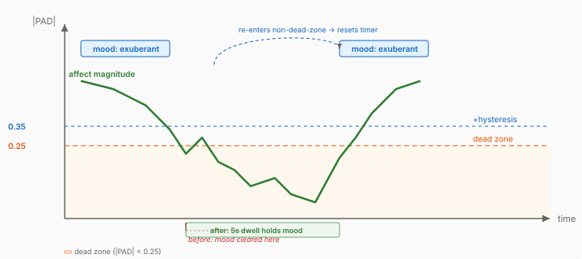

Continues from [The protocol that couldn't feel](2026-11-18-mdp04-the-protocol-that-couldnt-feel.md).

# The mood that flickered

The MoodMapper shipped with two protections against oscillation. Hysteresis widens the exit threshold by 0.1 — once a mood is adopted, the affect magnitude has to clear 0.35 instead of 0.25 to change. A five-second dwell timer holds the current mood through transient spikes — hostile for one tick doesn't flip the face. Both protections handled octant-to-octant transitions correctly. Neither handled the transition to neutral.

When affect magnitude drops below the dead zone (0.25), `classify()` returns null. The original code cleared the adopted mood immediately on null — no dwell, no hysteresis. If PAD values oscillate near the boundary, the mood vanishes and reappears on alternating ticks. The avatar's expression flickers.



The fix tracks when the dead zone was entered and enforces the same five-second dwell before clearing. Affect has to stay consistently below the threshold for the full dwell period. Exiting the dead zone resets the timer — a brief dip doesn't accumulate toward clearing.

```java
if (candidate == null) {
    if (adopted == null) return null;
    if (deadZoneEnteredAt < 0) deadZoneEnteredAt = now;
    if ((now - deadZoneEnteredAt) < DWELL_MS) return adopted;
    adopted = null;
    deadZoneEnteredAt = -1;
    return null;
}
deadZoneEnteredAt = -1;
```

The pattern is worth noting because it's easy to get hysteresis half-right. The two transitions — entering a state and leaving it — look symmetric but aren't. Entering a mood requires clearing a threshold and surviving a dwell timer. Leaving a mood (to null) had neither. The fix is six lines; the gap survived testing because every test exercised octant-to-octant transitions, not adopted-to-null.

## Estimation beats absence

Streaming TTS engines deliver audio progressively. Word-boundary timing — the `MarkTiming` data that tells the client when each word starts in the audio buffer — requires the full waveform. Result: in the streaming path, every gesture cue had `offsetMs: 0`. Gestures piled up at segment start instead of firing at word boundaries.

The non-streaming path gets exact timing from the TTS engine. The streaming path can't. But character-proportional estimation is better than zero:

```
offsetMs = (charOffset / textLength) × estimatedDurationMs
```

A gesture anchored to the middle of a 40-character sentence fires at roughly the midpoint of the estimated audio. Speech rate isn't uniform — stressed syllables stretch, function words compress — so the estimate is wrong in absolute terms. It's approximately right. Zero is never approximately right.

The same `estimatedDurationMs` already drives viseme estimation in the streaming path, so the formula is consistent with the visual timing the client already receives. The client's trigger formula — `max(0, offsetMs - strokeMs - 150)` — absorbs the estimation error naturally. A 200ms offset error on a head nod with 150ms stroke preparation shifts the trigger by 200ms. Noticeable in a timing analysis; invisible in conversation.

## Thread safety by construction

Four threads write to the WebSocket: the turn executor, the STT polling thread, the proactive tick thread (mood messages), and the silence attention policy. All call `connection.sendTextAndAwait()`. No lock, no routing through a shared executor.

Vert.x serializes all frame writes on the event loop. Concurrent callers hand their buffers to the event loop thread, which writes them in arrival order. The design is safe by construction — not because we added synchronization, but because the framework guarantees it. Verification took reading the framework source, not writing a wrapper.

The practical lesson: know your framework's threading model before adding locks. An unnecessary `synchronized` block is not harmless — it introduces contention and signals to future readers that the code has a concurrency problem it doesn't have.
