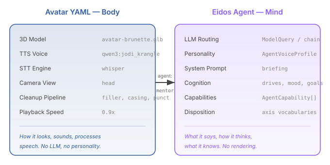

# The Avatar Is Not the Agent

The speech-demo had a problem disguised as a feature. It worked — a 3D character with lip-sync, voice synthesis, and an LLM behind it. You talked, it listened, it responded. But the entire thing was hardcoded: sixty voice entries hand-written in a Java producer, three LLM models as HTML option tags, the system prompt in `application.properties`. Every consumer who wanted an avatar had to copy `SpeechProducers.java` and start editing.

The obvious fix was "make it configurable via YAML." But the interesting question was what the YAML should configure, and what it shouldn't.

## The wrong split

The first instinct was to put everything in one YAML file — 3D model, voice, LLM, personality, system prompt, cognition settings. That's how the speech-demo worked: one app, one config surface, everything in one place. A flat definition:

```yaml
avatar:
  model: avatar-brunette.glb
  voice: qwen3:jodi_krangle
  llm: claude-haiku-4-5
  personality: mentor
  system-prompt: "You are a training coach..."
  cognition: true
  tenant-id: training
```

It looked clean. It was also wrong in three different ways.

The LLM routing already exists in the platform — `AgentProvider` with `ModelQuery` and `ModelChain` for capability-based model selection, fallback chains, vendor preferences. Putting `llm: claude-haiku-4-5` in the avatar YAML would mean duplicating that stack or bypassing it entirely. The personality — register, accent, speech patterns, catchphrases — already lives in eidos as `AgentVoiceProfile`. The system prompt is the agent's `briefing`. Cognition (drives, mood, goals) is configured via `CognitionDefinition`, owned by the agent. And `tenant-id` is infrastructure the platform resolves at runtime — the YAML author shouldn't even know it exists.

The avatar YAML was trying to be two things at once: a body and a mind.

## The right split



The avatar is a body. It's the physical rendering and speech pipeline — how the agent looks, sounds, and processes audio. The agent is the mind — what it says, how it thinks, what it knows. These are different concerns with different lifecycles, different owners, and different reasons to change.

The avatar YAML binds a body to a mind with a single field:

```yaml
avatar:
  agent: mentor-coach
  model: avatar-brunette.glb
  tts-voice: qwen3:jodi_krangle
  camera-view: head
  tts:
    engines:
      - type: kokoro
        voices: [af_heart, af_bella]
      - type: qwen3
        voices: [ryan, serena]
  stt:
    type: whisper
```

That `agent: mentor-coach` is a reference to an eidos `AgentDescriptor`. The descriptor carries everything the mind needs — LLM routing, voice personality, cognition, system prompt. The avatar YAML carries everything the body needs — 3D model, TTS engines, STT engine, cleanup pipeline, camera. Neither duplicates the other.

This means the same agent can inhabit different bodies. A mentor agent could appear as a full 3D character in one context and as a voice-only interface in another — same personality, same cognition, different avatar YAML. Or conversely, the same 3D model could be driven by different agents — a training coach and a customer service rep sharing a visual identity but bringing entirely different minds.

## The monolith problem

The same kind of entanglement existed on the frontend. `casehub-avatar-panel` was a 293-line Lit component that owned the WebSocket connection, hardcoded 88 voice entries in a constant, rendered the 3D scene, the transcript, the mic button, and the model selectors — all in one shadow DOM. If you wanted the avatar head in one tile and the transcript in another, you couldn't. The component decided its own layout.

The decomposition followed naturally from the body/mind split. An `AvatarSession` service owns the WebSocket and publishes typed events. Each sub-component — `casehub-avatar` (3D scene), `casehub-transcript` (chat log), `casehub-speech` (mic), `casehub-avatar-controls` (selectors) — subscribes to the events it cares about. The host decides the layout. The panel survives as a convenience wrapper for the common case.

The controls component has zero hardcoded options. It fetches the available voices and LLMs from `/api/avatar/config` — a REST endpoint that serves the compiled YAML. The source of truth is the YAML file; the UI renders whatever the YAML declares.

## What this opens up

The separation makes the avatar a building block rather than an application. Any CaseHub mosaic app can embed an avatar by dropping a YAML file and a `<casehub-avatar>` element. The backend discovers the YAML at build time, registers the CDI beans, serves the config. The frontend fetches the config and connects. No Java producers to copy, no voice lists to maintain, no LLM routing to wire.

More interesting: the same architecture supports avatars that aren't conversational. A training scenario could use the avatar as a visual presence with pre-scripted responses. A monitoring dashboard could use it as a status indicator — mood and gestures driven by system state rather than user speech. The body is generic; the mind is the variable.
