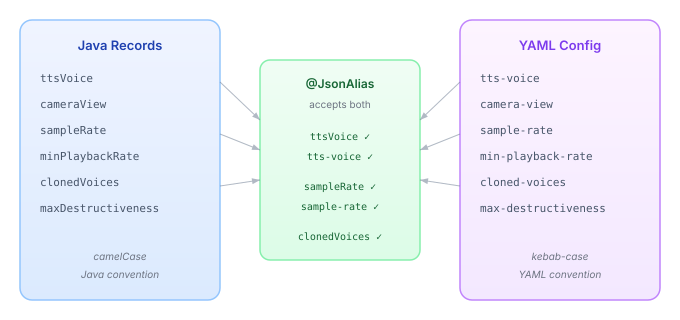

# The Config Your Fingers Expect

The design spec for the avatar YAML showed kebab-case properties — `tts-voice`, `camera-view`, `sample-rate`. The actual Java records accepted only camelCase. The spec was aspirational; the code was literal. Anyone who wrote the YAML the way the spec showed it would get an `UnrecognizedPropertyException` and no explanation of what went wrong.

This is a small gap, but it's a common one, and the fix is worth talking about because the obvious answer is wrong.

## The obvious wrong answer

The first instinct is to change `@JsonProperty("ttsVoice")` to `@JsonProperty("tts-voice")`. That's what the YAML should look like, so make the code match. But `@JsonProperty` does two things: it names the property for deserialization *and* for serialization. Change it to `tts-voice` and every existing consumer that reads `ttsVoice` from JSON responses breaks. Worse, the Java accessor is still `ttsVoice()` — the record component name doesn't change — so the serialized output and the accessor would disagree about what the field is called.

The other wrong answer is `PropertyNamingStrategies.KEBAB_CASE` on the ObjectMapper. That converts *all* property names, including ones that are already single words. It also applies globally — you'd need a separate ObjectMapper or mixin for every record that mixes single-word and multi-word properties. And it makes the camelCase form stop working, breaking existing YAML files.

## The right answer: aliases, not renames



Jackson's `@JsonAlias` accepts alternative names for deserialization without changing the canonical property name. The canonical name stays camelCase (what `@JsonProperty` declares, what `ttsVoice()` returns, what serialization produces). The alias adds kebab-case as an accepted input. Both forms work. Nothing breaks.

The pattern looks like this:

```java
@JsonProperty("ttsVoice") @JsonAlias("tts-voice")
@Nullable String ttsVoice,

@JsonProperty("sampleRate") @JsonAlias("sample-rate")
@Nullable Integer sampleRate,
```

For records without a `@JsonCreator` factory, `@JsonAlias` goes on the record component directly:

```java
public record TtsEngineSpec(
        String type,
        List<TtsVoiceSpec> voices,
        @JsonAlias("cloned-voices") @Nullable List<String> clonedVoices) {
```

Six properties across three records — `AvatarDefinition`, `TtsEngineSpec`, `CleanupConfigSpec`. Every multi-word camelCase property now accepts its kebab-case equivalent.

## The broader principle

Config surfaces have two audiences with different conventions. The Java code that declares the shape of the config uses camelCase because that's what Java identifiers do. The YAML author who writes the config file expects kebab-case because that's what YAML conventions do. Neither audience is wrong. The serialization layer's job is to bridge the gap without forcing either side to adopt the other's convention.

`@JsonAlias` is the right primitive for this because it's additive. It doesn't rename anything — it just widens the set of names that resolve to the same field. The canonical name stays in the language of the code. The alias speaks the language of the config file. When a third convention shows up (and it will — snake_case from a Python consumer, perhaps), another alias costs one annotation.

The alternative — picking one convention and forcing everyone to use it — always trades one audience's comfort for another's confusion. Aliases avoid the trade entirely.
