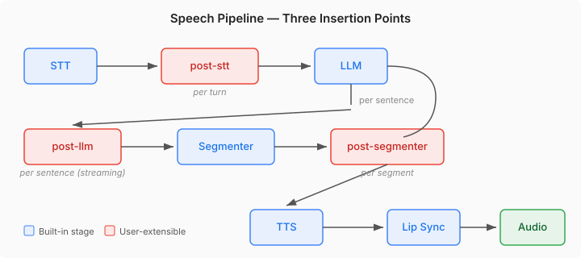

# From Flat Config to Step Chains

The avatar's speech pipeline has been a fixed sequence since it was built: STT captures audio, cleanup filters clean the transcript, the LLM generates a response, TTS synthesises it, lip sync maps phonemes to visemes. If you wanted to add a step — a vocabulary filter after STT, a profanity check on LLM output — you wrote Java. The pipeline shape was hardcoded in `SpeechWebSocket.onOpen()` and `TurnExecutor.processUserTurn()`.

Issue #536 makes it composable. An optional `pipeline:` section in `avatar.yaml` lets you insert custom text-processing steps at three points, with explicit ordering and registry-based discovery.

## The design tension: CleanupConfig sorts

The first instinct was to compile pipeline steps into `CleanupConfig`, the existing filter composition type from `connectors-voice-spi`. It's already used everywhere — `SpeechSession.handleStop()` calls `cleanupConfig.apply(raw)`, done.

The review caught why that doesn't work. `CleanupConfig`'s constructor sorts filters by destructiveness ascending:

```java
filters = filters.stream()
    .sorted(Comparator.comparingInt(TextFilter::destructiveness))
    .toList();
```

That's correct for the default cleanup chain — you want filler removal (destructiveness 0) before grammar correction (destructiveness 3). But a user-specified pipeline where YAML ordering is the contract can't have its steps silently reordered. If I write `[grammar, casing]`, I mean grammar first.

The fix: `FilterChain`. Same `apply()` loop, but it preserves insertion order. `CleanupConfig` is still used for the backward-compatible default — when no `pipeline:` section exists, the existing destructiveness-sorted chain runs unchanged.

## Three insertion points, three granularities

The pipeline isn't a single linear chain. The streaming architecture imposes different granularities at different points:



| Point | What steps see | Why |
|-------|---------------|-----|
| `post-stt` | Full transcription | STT delivers complete text before the LLM runs |
| `post-llm` | One sentence at a time | Streaming callback fires per sentence — the full response doesn't exist yet |
| `post-segmenter` | Individual segment text | Each segment goes to TTS independently |

The post-LLM granularity was the subtlest part to get right. In the streaming path, `streamingGenerator.generate()` fires a callback per sentence as the LLM produces it. The segmenter runs inside that callback. Post-LLM filters see one sentence, not the full turn. This is a real constraint — a filter that needs cross-sentence context won't work here — but it's the right constraint. The alternative (buffering the full response before filtering) would break streaming latency.

## The registry pattern

Custom steps implement `TextFilter` from `connectors-voice-spi` — the same interface the built-in cleanup filters use. No new SPI needed for the common case (text-to-text transforms).

Discovery follows the `SummariserRegistry` pattern already in the repo: name-to-factory mapping, resolved at compilation time.

```yaml
cleanup:
  max-destructiveness: 3    # drives default post-stt chain

pipeline:
  post-llm:
    - name: profanity-filter
      config:
        dictionary: custom-words
```

`pipeline:` and `cleanup:` coexist. Each insertion point in `pipeline:` overrides only that position — undeclared positions use defaults. So you can add a post-LLM filter without having to replicate the entire post-STT cleanup chain.

## What it doesn't do

Three things are explicitly deferred:

**Non-text step types.** Audio transforms (volume normalisation, effects) would need a new SPI. No concrete use case exists today.

**Async side-effects.** A logging step that shouldn't block the turn pipeline would need a wrapper with virtual-thread dispatch. The initial design had a convention for this (negative destructiveness), but the review correctly identified it as unimplementable with `CleanupConfig`'s apply loop. Deferred until a consumer needs it.

**CorrectionHooks integration.** The existing `corrector` parameter in `SpeechSession` is functionally a post-STT text filter. It should become a registered pipeline step, replacing the constructor parameter. Follow-up.

## What it opens up

The obvious use case is domain-specific vocabulary correction — medical transcription, legal terms, product names. The STT gets "atrial fibrillation" wrong consistently; a post-STT vocabulary filter fixes it without touching the STT model.

But the per-sentence post-LLM insertion point is more interesting. It's where policy enforcement lives: profanity filters, PII redaction, compliance checks. These need to run before TTS, and they need to run per-sentence to not break streaming. That's exactly what the pipeline gives you.
