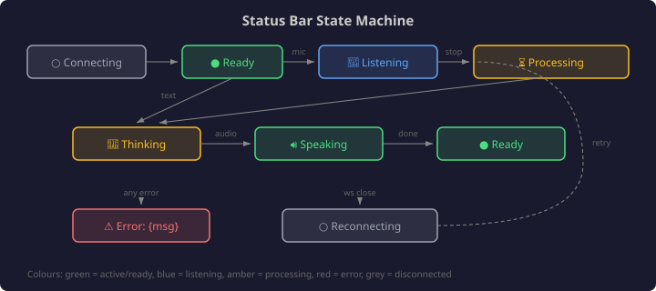
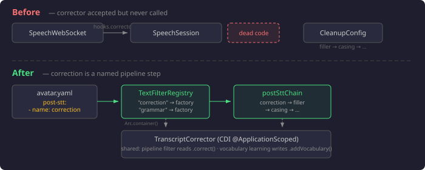

# Dead Code and Missing Signals

Two small issues in the speech demo exposed the same pattern: wiring that looked complete but wasn't doing anything.

## The status bar that couldn't keep up

The speech demo had a plain text status indicator — `statusEl.textContent = msg` with no visual differentiation. Replacing it with a colour-coded bar was straightforward: a `STATUS_STATES` lookup object maps each pipeline state to an icon, label, and CSS class. CSS transitions handle smooth colour fades between states. The bar now shows green for ready/speaking, blue for listening, amber for processing/thinking, red for errors, grey for disconnected.



The interesting part was what broke once the bar was visible. With the 3D avatar head active, the status got stuck on "Thinking" after every message. The bar made a gap obvious that plain text had hidden.

The cause: `AvatarEngine` had two code paths for audio playback — one with the TalkingHead 3D renderer, one headless. The headless path emitted `'Speaking...'` and `'Ready'` status messages. The head path called `_enterFloorState(FloorState.SPEAKING)` and `_enterFloorState(FloorState.IDLE)` for body animation, but never told the status bar. The floor state drove the avatar's posture; the status bar drove the user's understanding. They were separate concerns sharing none of their state transitions.

The fix was three `this._emit('status', ...)` calls in `_handleAudioWithHead`, `_checkTurnFinished`, and `_handleTurnComplete`. The status bar now tracks the full pipeline lifecycle regardless of rendering mode.

## The corrector that never ran

The other issue was about `CorrectionHooks.corrector()` — a `UnaryOperator<String>` that wrapped `TranscriptCorrector` for fixing STT transcription errors. It had been wired through four constructor overloads of `SpeechSession`, passed by `SpeechWebSocket`, created by `AvatarRecorder` from CDI.

None of that mattered. The main constructor accepted the parameter and silently dropped it:

```java
public SpeechSession(... UnaryOperator<String> corrector, ...) {
    this.sttService = sttService;
    this.pipeline = pipeline;
    // corrector is never stored, never used
}
```

The parameter survived across four overloads because each delegated to the next, and nobody noticed the terminal constructor didn't store it. The corrector was architecturally present and functionally absent.



The fix moved correction into the composable pipeline that issue #536 had just built. `TranscriptCorrector` is now a named `TextFilter` registered as `"correction"` in the `TextFilterRegistry`, referenced via YAML:

```yaml
pipeline:
  post-stt:
    - name: correction
```

The wrinkle was instance sharing. `TranscriptCorrector` has mutable state — `addVocabulary()` lets it learn terms from LLM responses to improve future corrections. The filter in the pipeline and the vocabulary learning in `CorrectionHooks.onResponse()` need the same instance. Both paths resolve `TranscriptCorrector` via `Arc.container().instance()`. Since it's `@ApplicationScoped`, CDI gives them the same singleton. The correction filter reads; the vocabulary hook writes. Same object, different access patterns.

The `corrector` field was dropped from `CorrectionHooks`, the parameter removed from all four `SpeechSession` constructors, and the dead wiring in `SpeechWebSocket` cleaned out. What was an unused constructor parameter is now a pipeline step that actually runs.
