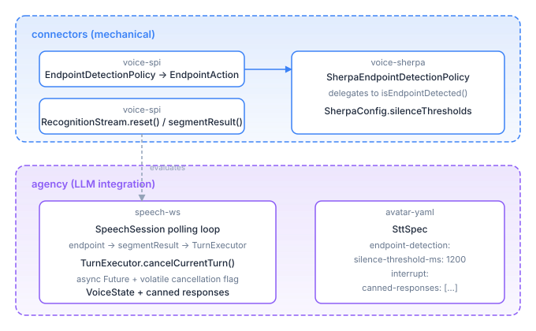
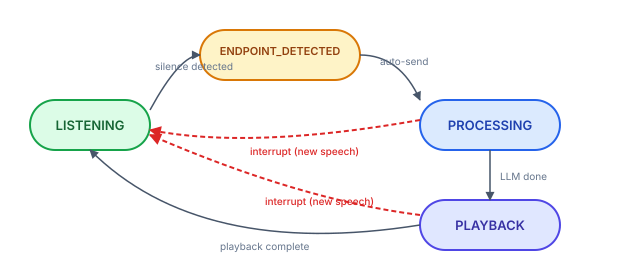

# Teaching an Avatar to Listen While It Talks

The avatar speech pipeline had a crude interaction model: press a button to talk, press again to stop, wait for the LLM to respond. It worked, but it felt like a walkie-talkie. Real conversation doesn't have a stop button — people pause, the other person starts talking, and if someone interrupts, the speaker yields.

We built the full endpoint detection and interrupt handling stack in a single session. Six issues, two repos, four layers.

## The Layered Split

The first design question was where the endpoint detection logic belongs. The obvious answer — put everything in agency alongside the speech session — was wrong for a subtle reason.

Endpoint detection itself is mechanical. A `RecognitionStream` accumulates audio. At some point, silence follows speech. The question "has the speaker paused?" is a property of the stream, not of what you plan to do with the answer. The *reaction* to a pause — sending the transcript to an LLM, cancelling in-flight work, playing a canned response — that's where the application-specific behaviour lives.

This maps to the repo boundary between connectors and agency. Connectors owns mechanical extensions — the patterns for using voice connections effectively, not just the raw bindings. Agency owns what happens when those patterns fire in an LLM-driven context.



The SPI in connectors is a `@FunctionalInterface`:

```java
@FunctionalInterface
public interface EndpointDetectionPolicy {
    EndpointAction evaluate(RecognitionStream stream, String currentPartial);
}
```

Three possible actions: `CONTINUE`, `ENDPOINT_DETECTED`, `FORCE_SEND`. The sherpa implementation delegates to the recogniser's built-in silence detection, with a guard against empty partials — silence-only segments shouldn't trigger auto-send.

## The Concurrency Problem

Making turns non-blocking was the hard part. The polling loop runs on a virtual thread, checking `partialResult()` every 100ms. When an endpoint fires, it needs to dispatch a user turn to the LLM — but that turn might still be running when the next endpoint fires. Or when the user presses stop.

`TurnExecutor.executeUserTurn()` previously blocked via `.get()`. We split it: the new version returns a `Future<?>`, and a separate `executeUserTurnBlocking()` preserves the synchronous path for `handleStop()` and `handleText()`. A `volatile boolean turnCancelled` flag, checked between sentences in the streaming generator callback, gates TTS submission. On cancel, pending TTS futures are explicitly cancelled.

The interaction between the polling thread (sets `turnCancelled`) and the executor thread (reads it) is clean because the flag is volatile and only transitions from false to true within a single turn lifecycle. The executor resets it to false at the start of each new turn.

## The State Machine

Four voice states track where the session is in the conversation lifecycle:



The interesting transitions are the red ones. When the polling loop detects new partial text during PROCESSING or PLAYBACK, that's an interrupt — the user resumed speaking while the avatar was still responding. The handler cancels the in-flight turn, sends the interrupted transcript (so the user's words aren't silently discarded), plays a pre-synthesised canned response, and returns to LISTENING.

The canned responses are synthesised at session start — a list of short phrases like "Go ahead" rendered to WAV bytes using the configured TTS voice. On interrupt, one is picked at random and sent as a binary audio frame. Zero LLM latency, zero TTS latency. The avatar yields instantly.

## YAML All the Way Down

The whole feature is configurable without code:

```yaml
stt:
  type: streaming-zipformer
  endpoint-detection:
    enabled: true
    silence-threshold-ms: 1200
    min-speech-ms: 500
  interrupt:
    enabled: true
    canned-responses:
      - "Sorry, please continue."
      - "Go ahead."
    pre-synthesise: true
```

When the `endpoint-detection` block is absent, it's push-to-talk — backward compatible. When present, the silence threshold maps to sherpa-onnx's rule2 (trailing silence after speech). The `interrupt` block controls whether the avatar can be interrupted mid-response.

The client side is a thin CSS layer. Voice state changes arrive as WebSocket messages; the mic button's `data-voice-state` attribute drives the visual — amber for endpoint detected, pulsing blue for processing, red for listening. No framework, no state management library. A `dataset` attribute and four CSS rules.

## What This Opens Up

The endpoint detection pipeline is the foundation for hands-free conversation. The next layer — issue #544's interrupt handler with its three-phase state machine — is already on the branch. Beyond that, the architecture supports more sophisticated endpoint policies: confidence-weighted silence thresholds, prosodic cues, even LLM-assisted turn-taking decisions. The `EndpointDetectionPolicy` SPI is deliberately minimal so these variations compose without changing the integration contract.
